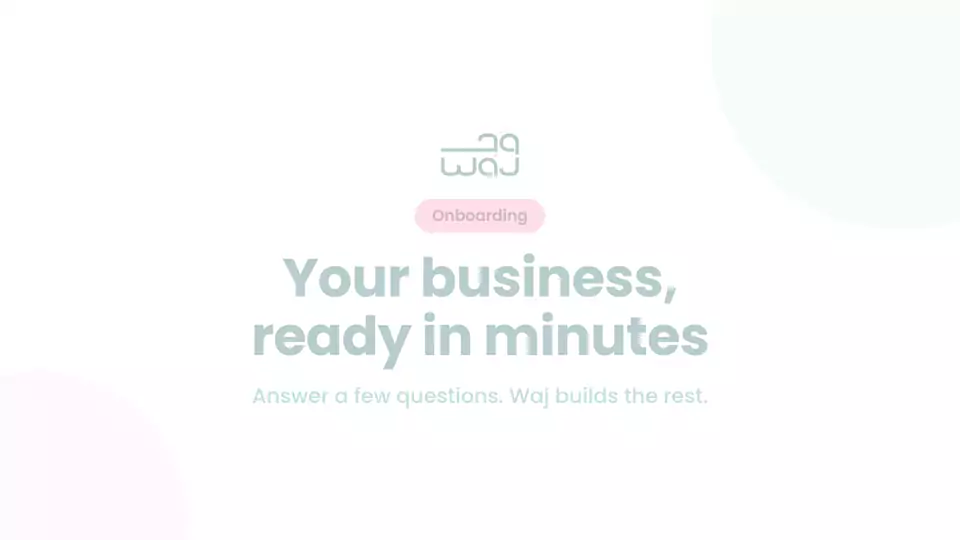
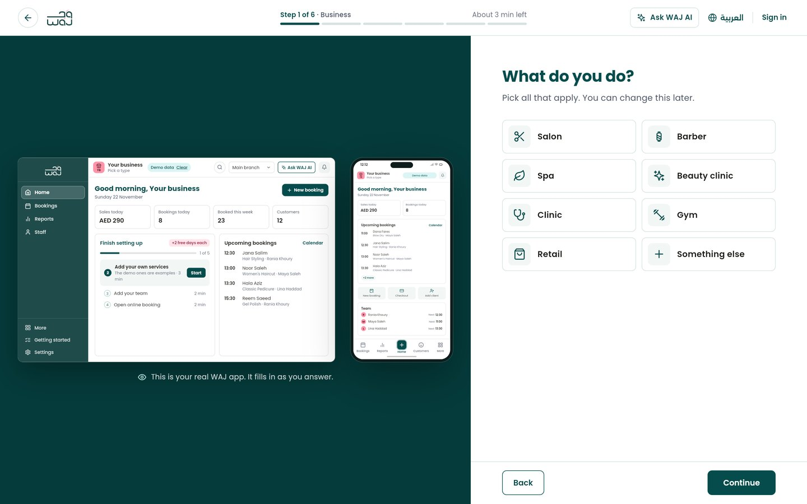
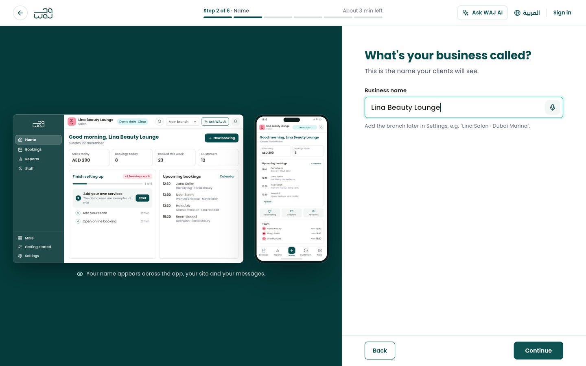
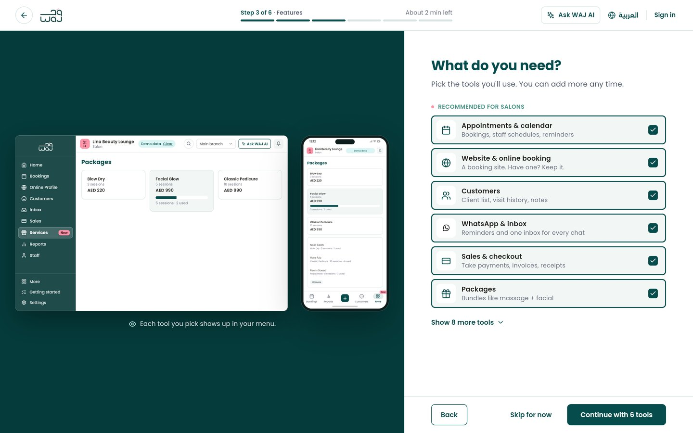
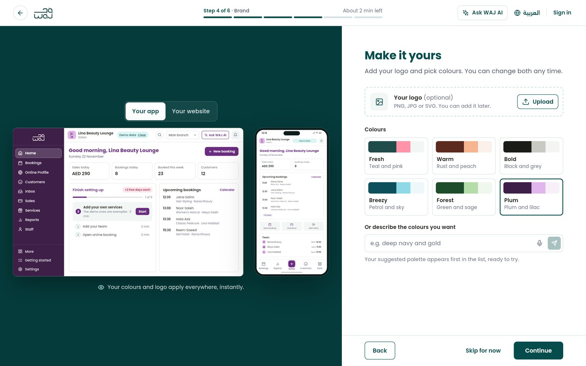
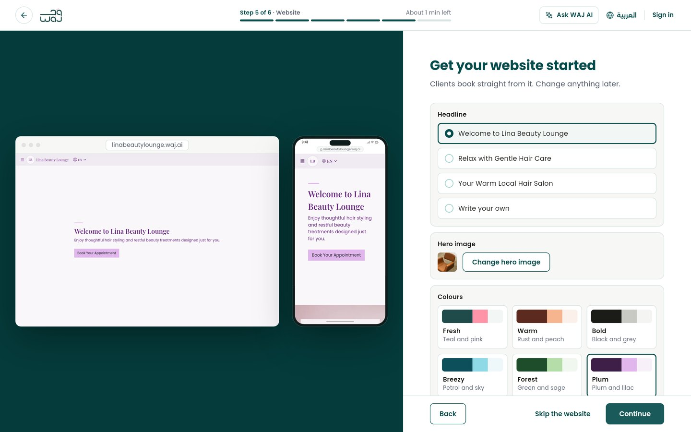
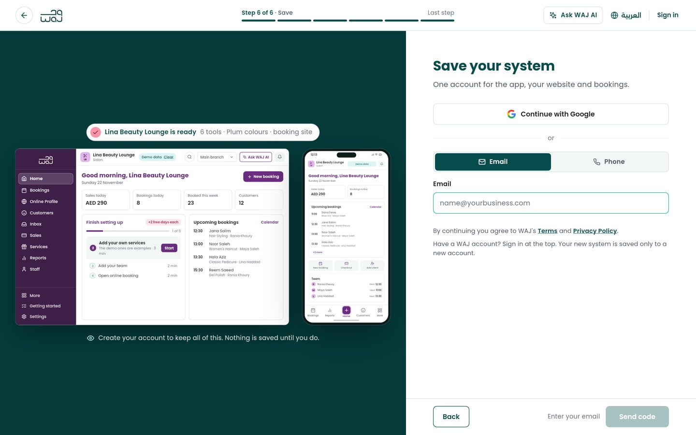

# Onboarding: your business, ready in minutes

[← All features](../)

▶ **Full video with sound:** [waj-onboarding.mp4](waj-onboarding.mp4) (30 s, 1920×1080)

Answer six quick questions and WAJ builds your system while you watch. Your real app fills in on the left as you answer: your name, your menu, your colours and your booking website. When you save, it's ready to use, with demo data so you can explore straight away.

**Where:** go to [login.waj.ai](https://login.waj.ai) and choose **Start building** · **Docs:** [Getting Started: Onboarding Your Business](https://waj.ai/docs/getting-started/onboarding-getting-started)

## How it works

### 1. Pick what you do
Salon, barber, spa, beauty clinic, clinic, gym or retail. You can pick more than one. WAJ uses your answer to suggest the right tools and demo data.

### 2. Name your business
Your name shows up right away across the app, your website and your messages.

### 3. Pick your tools
Appointments, website, customers, WhatsApp and inbox, sales and checkout, packages and more. Each tool you pick shows up in your menu.

### 4. Make it yours
Add your logo and pick a colour palette, or describe the colours you want. The colours apply to both your app and your website at once.

### 5. Get your website started
Pick an AI-written headline (or write your own), a hero image and colours. Clients book straight from the site.

### 6. Save your system
Create your account with Google, email or phone. Your system is ready, with demo data to explore.

## Good to know
- Nothing is saved until you create your account in the last step.
- You can change your business type, tools, colours and website at any time.
- The flow is available in English and Arabic.
