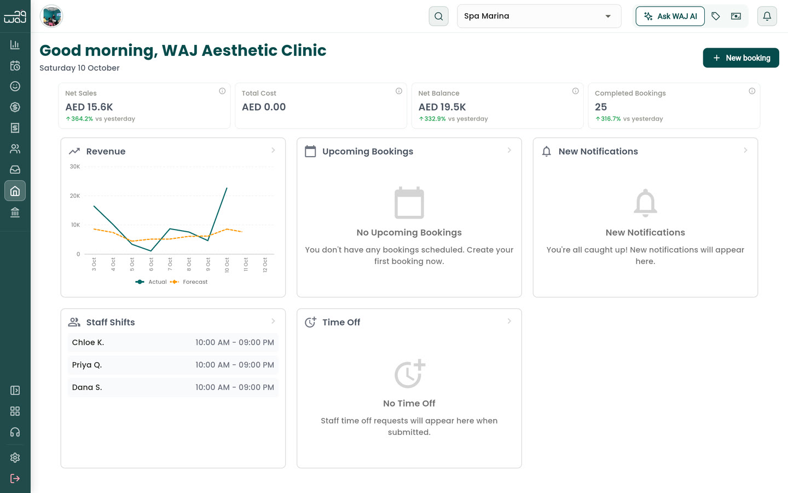
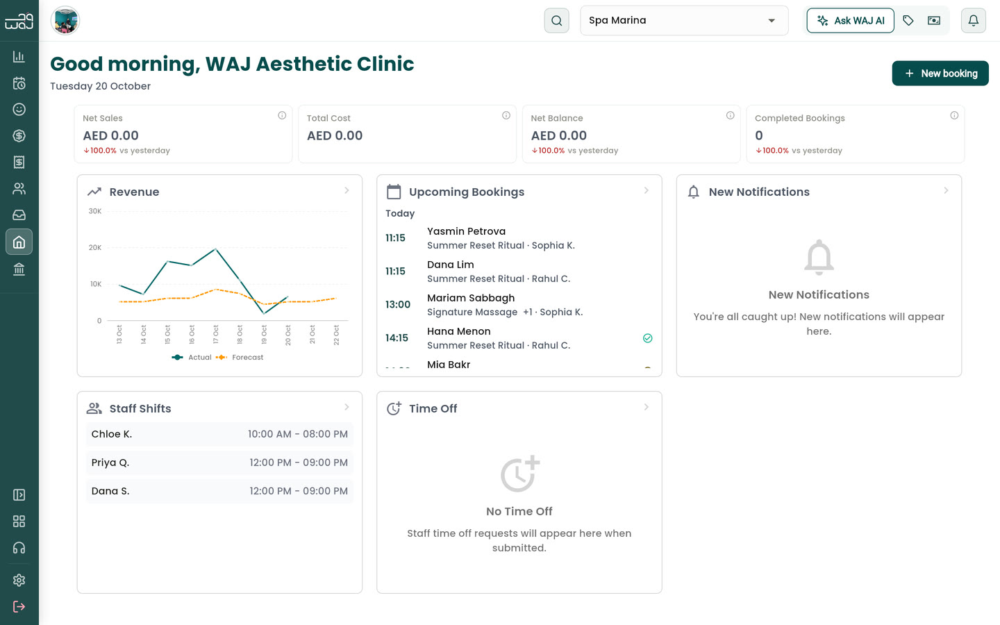
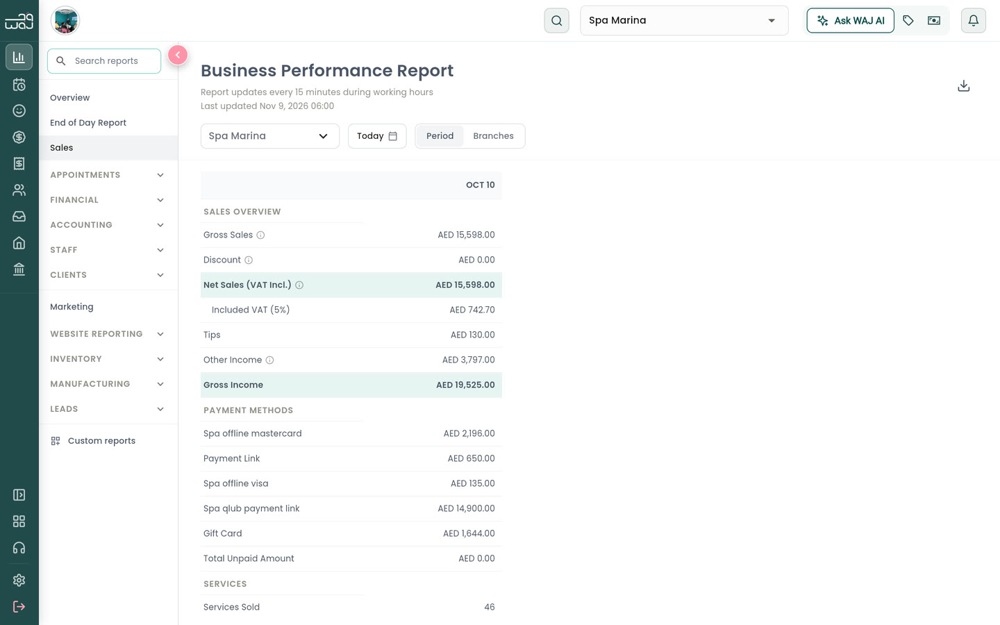

# Home dashboard: your day at a glance

[← All features](../)

▶ **Video:** [waj-home-dashboard.mp4](waj-home-dashboard.mp4) (26 s, 1920×1080)

Home is where your day starts. Today's sales, costs, balance and completed bookings sit at the top, with a revenue chart, your next bookings and today's staff shifts underneath. Tap any number to open the report behind it.

**Where:** **Home** in the side menu · **Docs:** [Home Dashboard](https://waj.ai/docs/getting-started/home-dashboard)

## How it works

### 1. Today's numbers
Net Sales, Total Cost, Net Balance and Completed Bookings, each compared with yesterday. The Revenue card charts every day against the forecast, so a strong or slow day stands out.

### 2. Who's coming, who's working
Upcoming Bookings lists the rest of today's appointments with the service and team member. Staff Shifts shows who is working and when. Time Off and New Notifications sit alongside.

### 3. One tap to the full report
Tap a number to drill in. Net Sales opens the Business Performance report with the full breakdown: gross sales, discounts, VAT, tips, payment methods and services sold.

## Good to know
- Everything on Home follows the branch you have selected at the top.
- Home needs the "View sales report" permission. Staff without it land on the Calendar.
- The number tiles need "Access other staff members' report".
- Upcoming Bookings only shows today's bookings that are still to come (not checked out or cancelled).
- Empty cards show a friendly message instead of a blank space.
