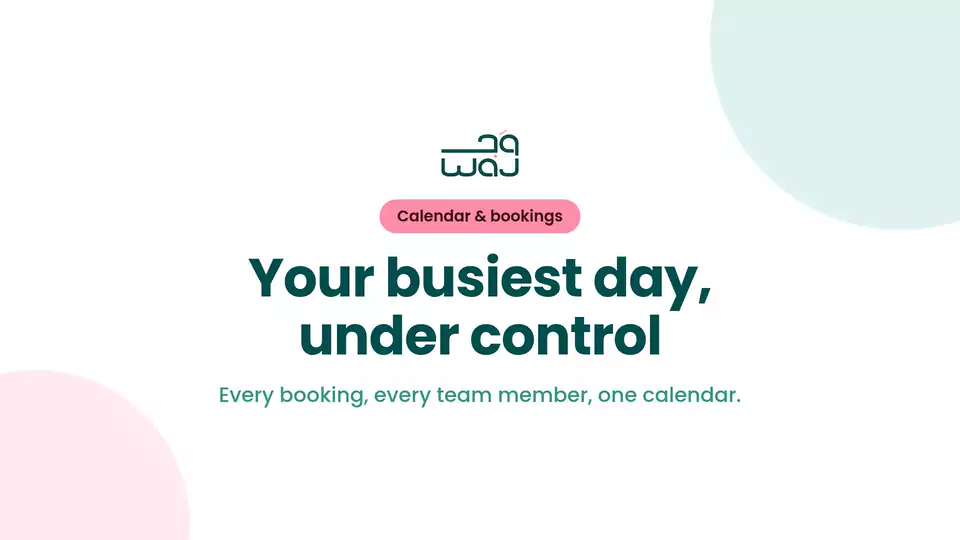
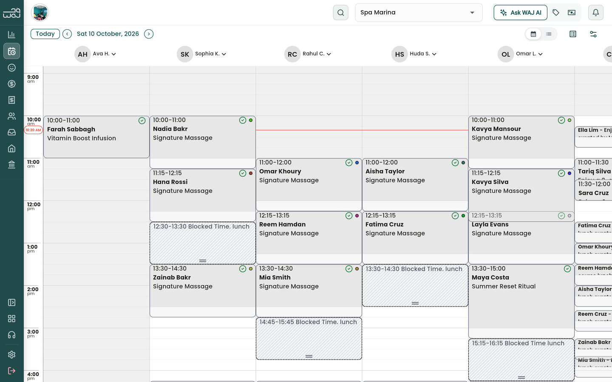
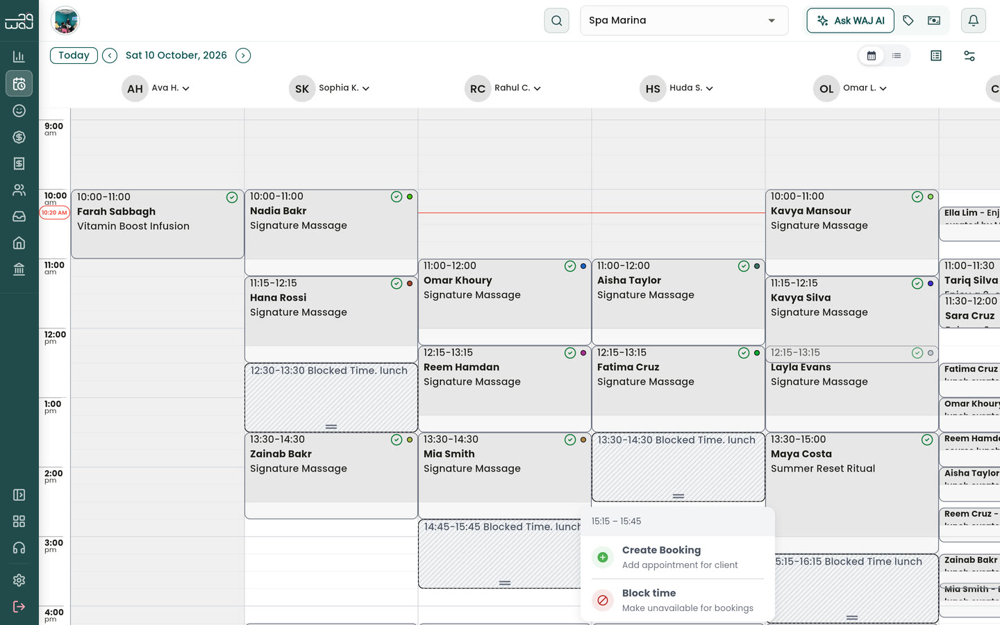
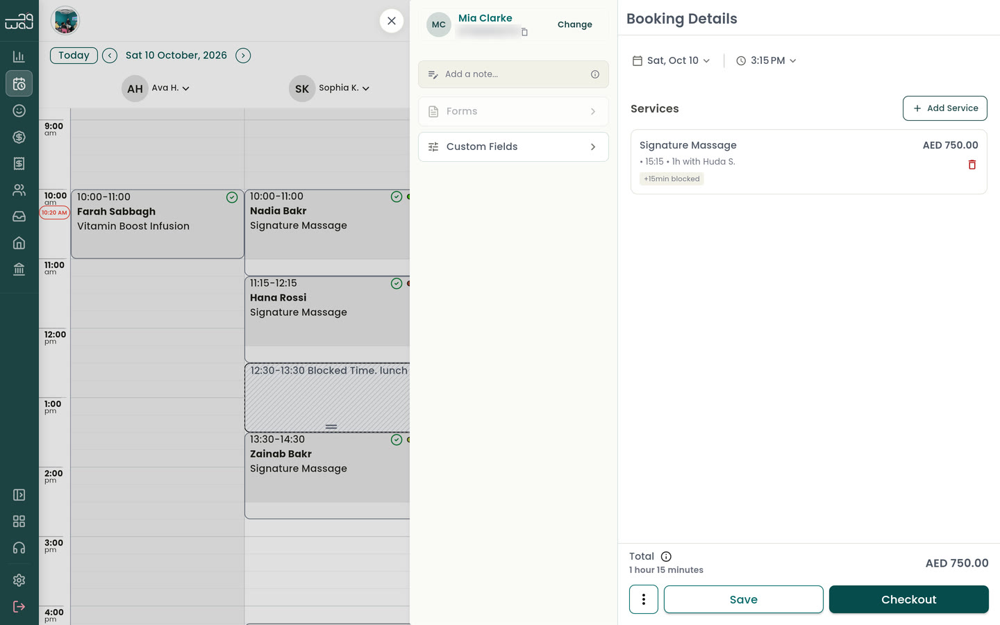
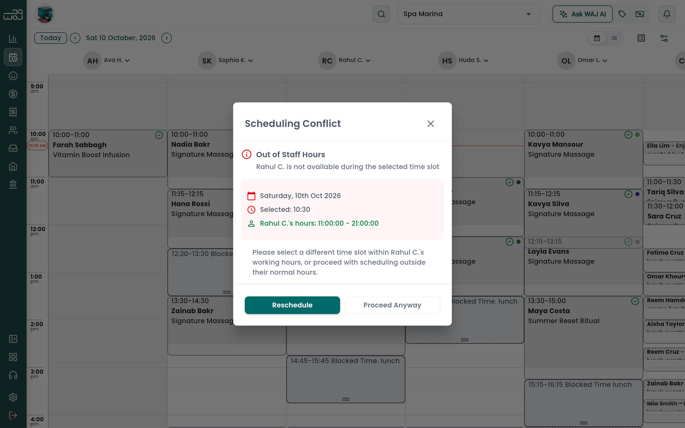
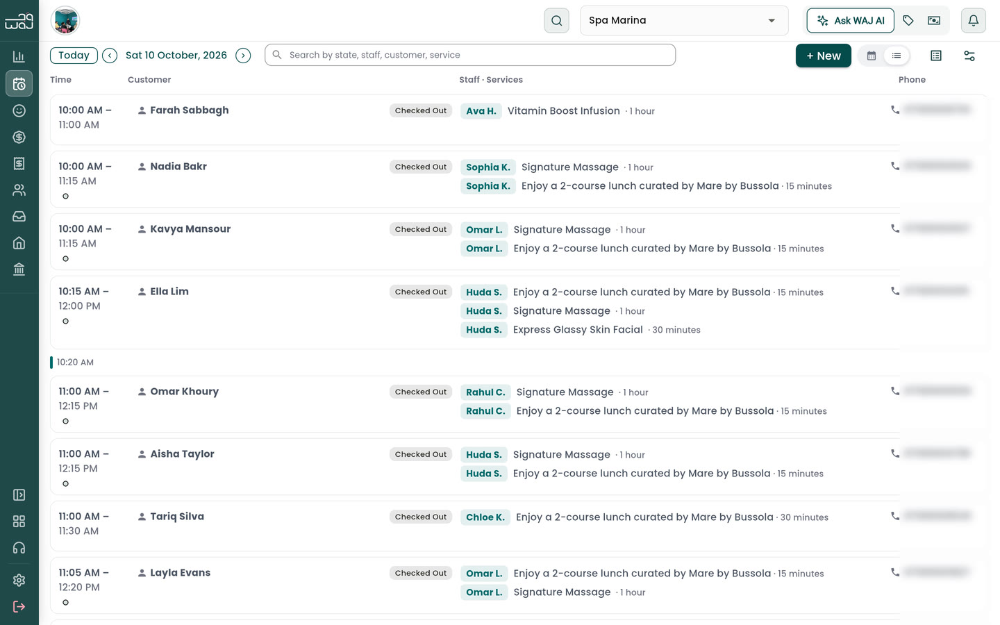

# Calendar & bookings: your busiest day, under control

[← All features](../)

▶ **Full video with sound:** [waj-calendar-bookings.mp4](waj-calendar-bookings.mp4) (33 s, 1920×1080)

The calendar shows your whole team side by side, one column per team member, so a packed day is easy to read. Tap a free slot to book: pick the client and the service, and WAJ fills in the team member, time and total. It flags slots outside someone's working hours, and one tap switches the day to a list.

**Where:** **Bookings** (calendar icon) in the side menu · **Docs:** [Calendar Views and Navigation](https://waj.ai/docs/calendar-and-bookings/calendar-views), [Creating a Booking](https://waj.ai/docs/calendar-and-bookings/create-a-booking), [Scheduling Conflicts and Calendar FAQ](https://waj.ai/docs/calendar-and-bookings/conflicts-and-faq)

## How it works

### 1. One column per team member
The day view shows every team member's bookings and blocked time next to each other, with a live line for the current time.

### 2. Tap a free slot
Tap any empty slot and choose **Create Booking** or **Block time**.

### 3. Client and service, the rest is filled in
Pick a client (or leave it empty for a walk-in), then search for a service. WAJ adds the team member, start time and duration, and shows the total. Finish with **Save** or **Checkout**.

### 4. Out-of-hours check
Choose a time outside a team member's working hours and WAJ shows a **Scheduling Conflict** with their hours. Pick another time with **Reschedule**, or **Proceed Anyway**.

### 5. Calendar or list
Switch to the list view to see the whole day as rows, with each booking's status, team member and services. Search by state, staff, customer or service.

## Good to know
- There is no month view. The longest span is one week.
- Drag a booking to reschedule it, or drag its bottom edge to change the duration. Times snap to 15 minutes.
- The filter panel narrows the calendar by team member, booking state, channel, creation date and service category.
- Every change after saving is kept in the booking's activity history.
- The calendar updates in real time.
