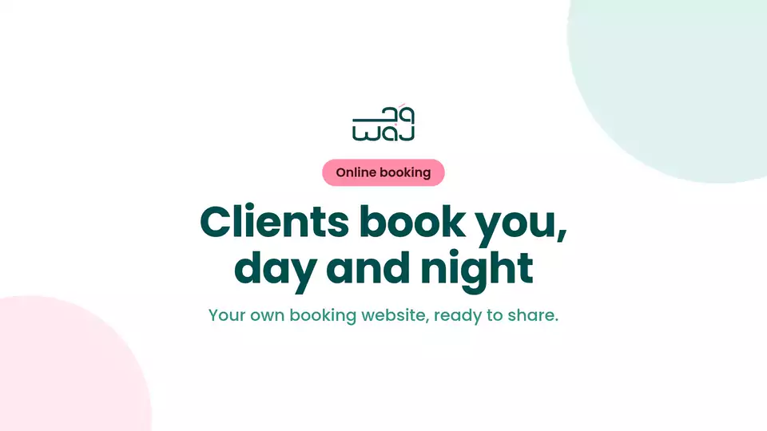
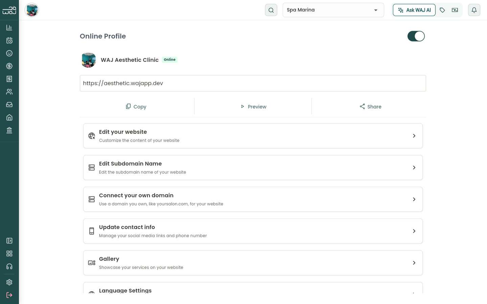
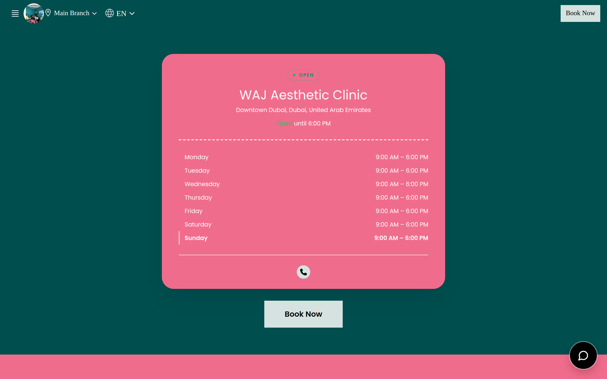
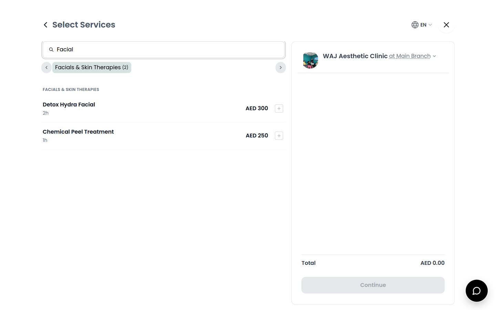
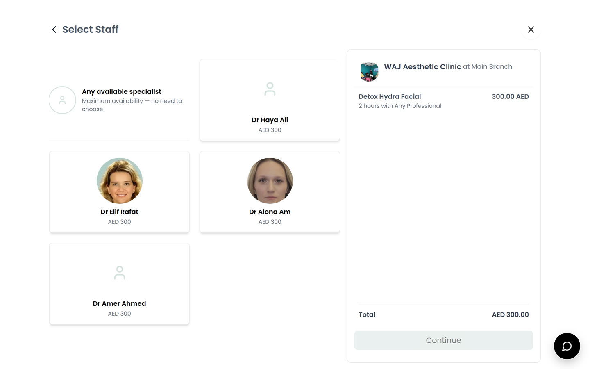
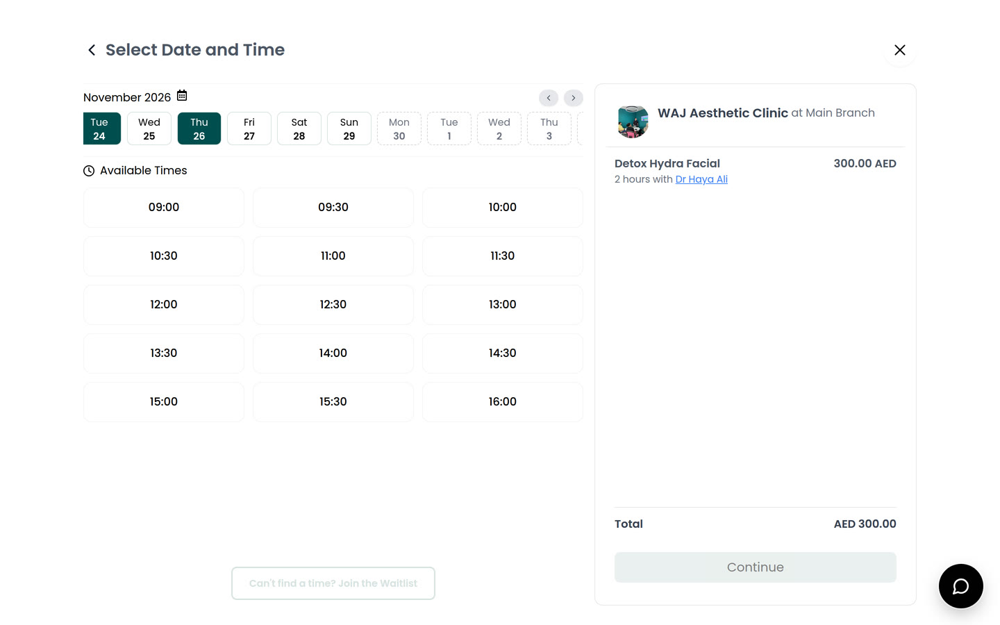
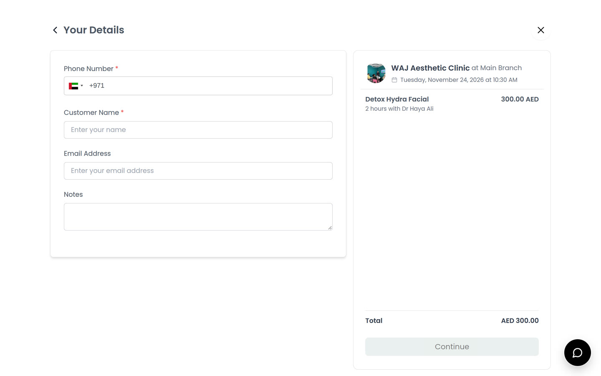

# Online booking: clients book you, day and night

[← All features](../)

▶ **Full video with sound:** [waj-online-booking.mp4](waj-online-booking.mp4) (33 s, 1920×1080)

Every WAJ business gets its own booking website. Share the link from your Online Profile, and clients can browse your services, choose a specialist and pick a free time, at any hour. Their booking lands in your calendar.

**Where:** **Online Profile** in the side menu · **Docs:** [Your Online Profile and Booking Website](https://waj.ai/docs/online-profile/online-booking-profile)

## How it works

### 1. Your Online Profile
Your website address, with **Copy**, **Preview** and **Share**, and an Online/Offline switch. From here you can also edit the website, the subdomain, your contact info, gallery and language.

### 2. Your booking website
Clients see your business, opening hours and a **Book Now** button on every page.

### 3. Pick a service
Clients search or browse your services by category and add one or more to their booking. The total updates as they go.

### 4. Pick a specialist
Choose a team member, or **Any available specialist** for the widest choice of times.

### 5. Pick a day and time
Only free times are shown. If nothing fits, clients can join the waitlist.

### 6. Add their details
Clients enter their phone number and name to finish. The summary shows the date, time, service and specialist.

## Good to know
- Turning the profile Offline pauses online bookings.
- Editing the website, the subdomain and the Online/Offline switch each need their own permission.
- No-Show Protection can charge a share of the booking price if a client does not turn up.
- The site is available in English and Arabic.
