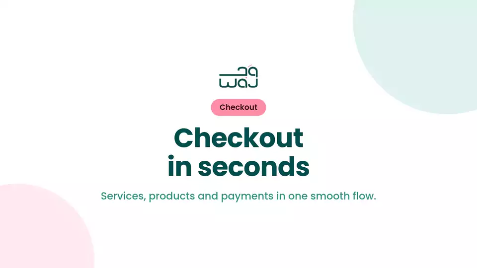
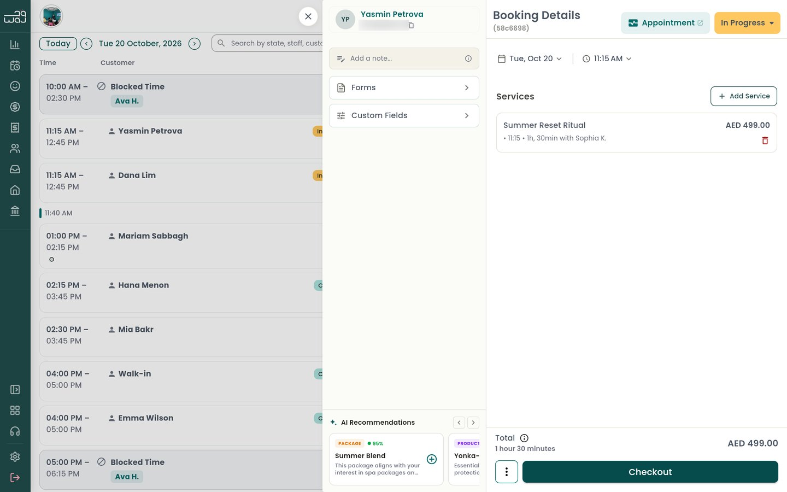
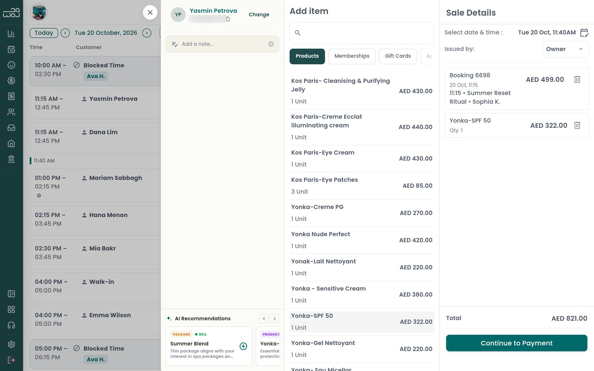
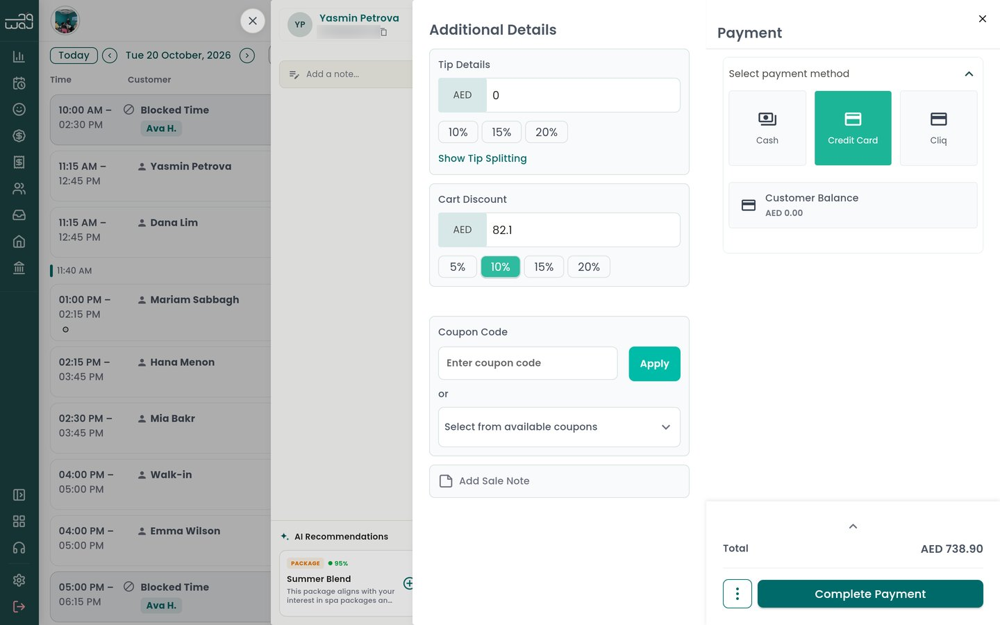
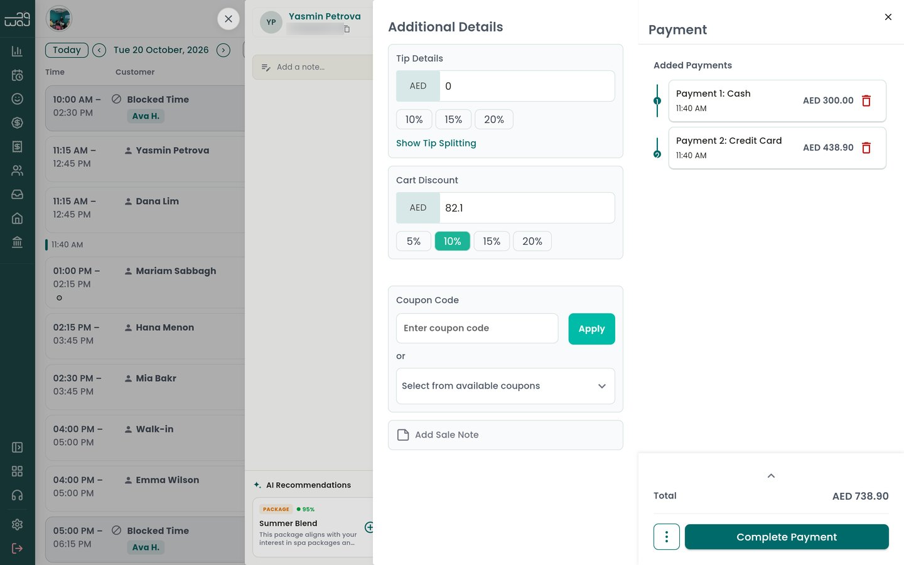
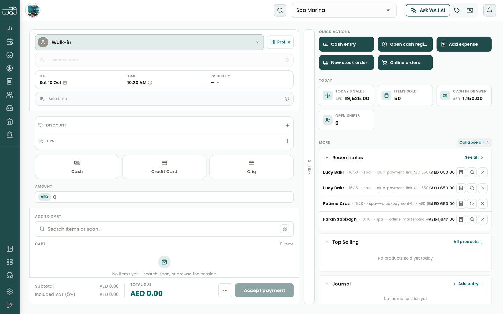
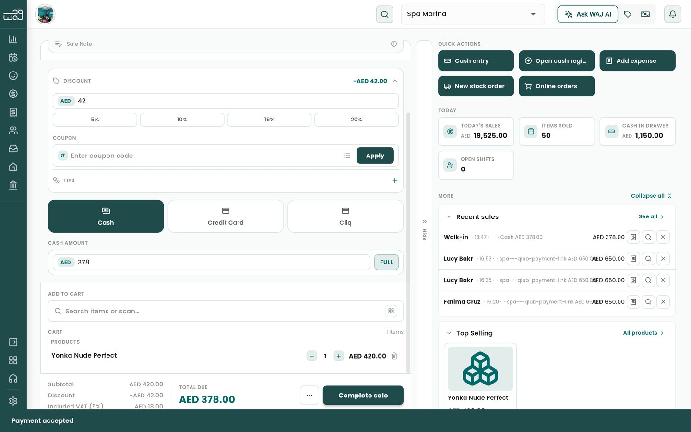

# Checkout and retail POS: checkout in seconds

[← All features](../)

▶ **Full video with sound:** [waj-checkout-pos.mp4](waj-checkout-pos.mp4) (41 s, 1920×1080)

Turn a booking or a walk-in into a paid sale in a few taps. The cart fills itself from the booking, you add products, apply a discount or tip, and take payment in one method or split across several. For over-the-counter sales, the Retail POS puts the cart, today's numbers and recent sales on one screen.

**Where:** open a booking on the calendar and tap **Checkout**, the tag icon in the top bar for a new sale, or **More → Retail POS** · **Docs:** [Unified Checkout and Taking Payment](https://waj.ai/docs/unified-checkout/unified-checkout) and [Retail POS](https://waj.ai/docs/unified-checkout/retail-pos)

## How it works

### 1. Start from a booking
Open any appointment on the calendar and tap **Checkout**. The booked services and their price are already there.

### 2. Add products
Browse products, memberships and gift cards, or search, and tap to add them to the cart. WAJ AI suggests packages and products that fit the client.

### 3. Discounts and tips
Pick a quick discount (5, 10, 15 or 20%) or type an amount, add a tip, or apply a coupon. The total updates right away, with VAT worked out for you.

### 4. Split the payment
From the **⋮** menu choose **Split Payment** and add payments until the total is covered, for example part cash and part card. The same menu lets you **Capture Deposit** or **Save Unpaid**.

### 5. Retail POS
A faster sale screen for walk-ins: search or scan items, pick a payment method, and see today's sales, items sold and cash in drawer at a glance. Quick actions for cash entry, the cash register and expenses sit next to it.

### 6. Sale done
Tap **Complete sale**. The sale shows up straight away in **Recent sales**, and the product appears under **Top Selling**.

## Good to know
- Checkout and Retail POS use the same pricing, discount, VAT and payment rules. Only the layout differs.
- Attach a customer to apply membership benefits or loyalty points. Pure retail sales can stay as walk-in.
- Discounts stack in a fixed order and can never take the total below zero.
- Retail POS is available to owners; other staff need the permission turned on.
- Every sale creates an invoice automatically.
