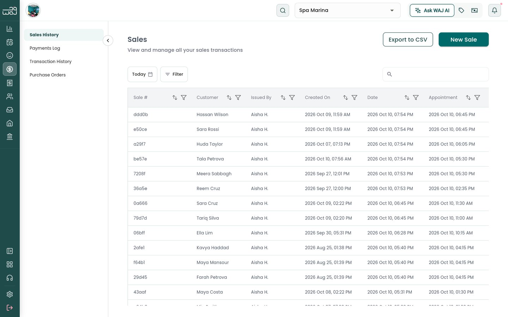
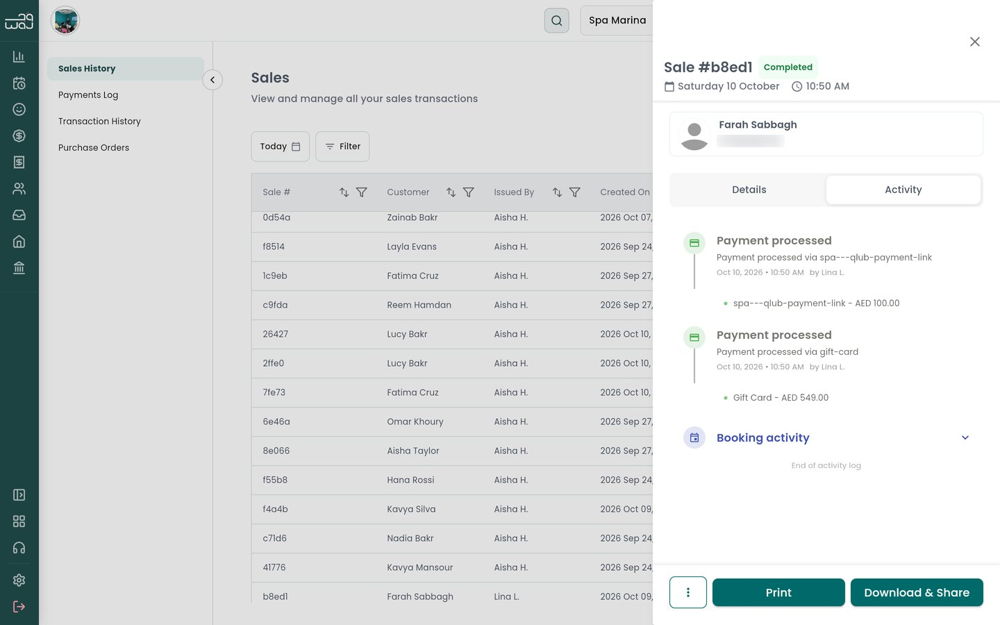
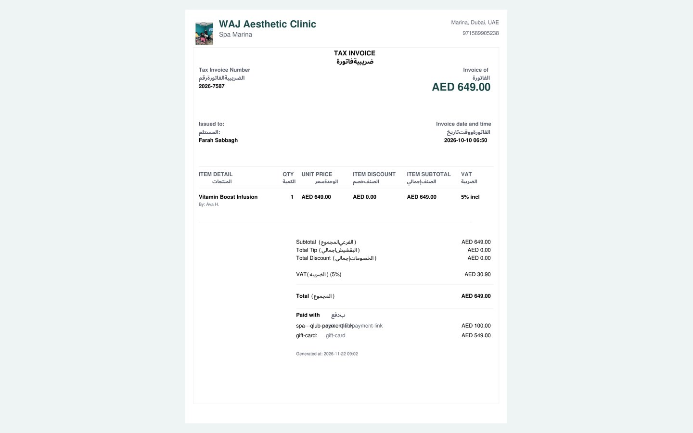
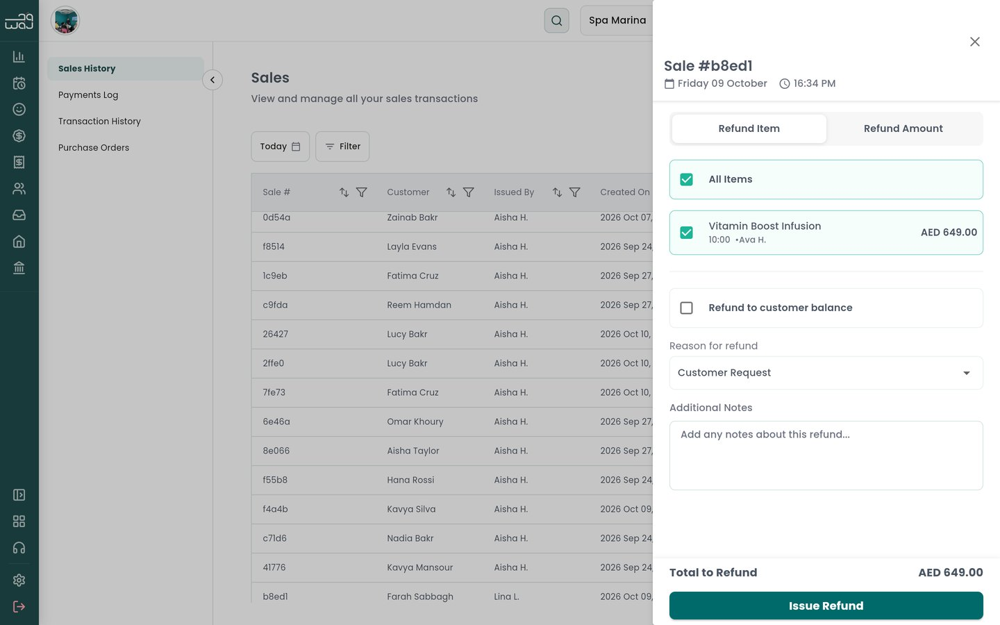
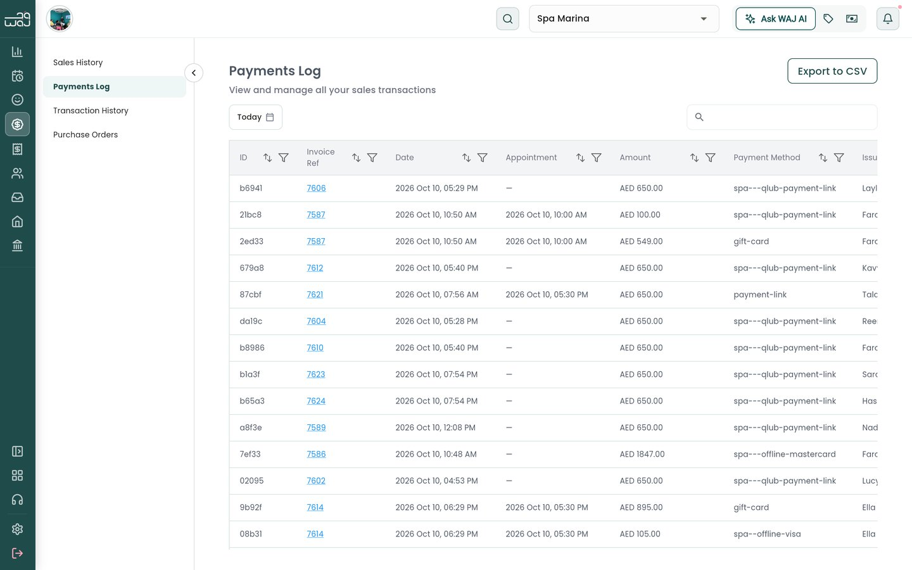
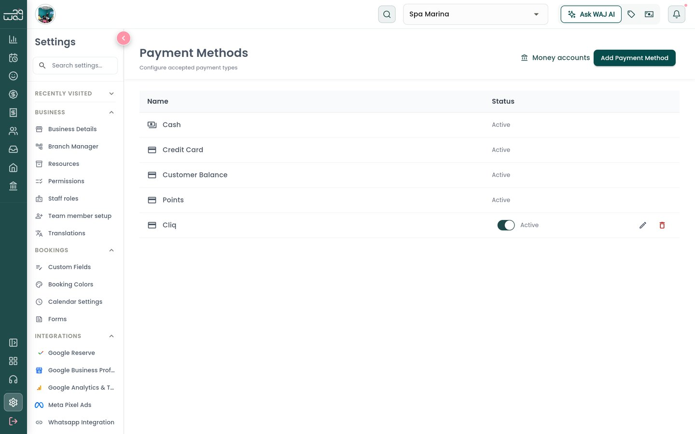
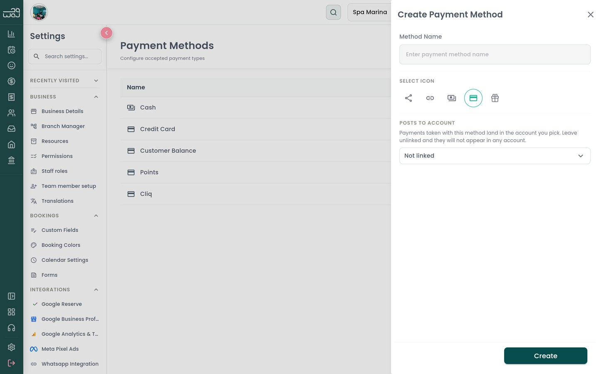

# Payments and invoices: every payment, on record

[← All features](../)

▶ **Full video with sound:** [waj-payments-invoices.mp4](waj-payments-invoices.mp4) (30 s, 1920×1080)

Every sale, payment and refund is on record and easy to find. Open any sale to see how it was paid, download its tax invoice, or refund it in a few taps. You choose which payment methods your team can take.

**Where:** **Sales** in the sidebar (Sales History, Payments Log, Transaction History) and **Settings → Payment Methods** · **Docs:** [Invoices and E-Invoicing](https://waj.ai/docs/payment/invoicing), [Refunds, Voids, Deposits and Unpaid Sales](https://waj.ai/docs/payment/refunds-voids-deposits) and [Payment Methods](https://waj.ai/docs/payment/payment-methods)

## How it works

### 1. Sales history
All sales for the branch in one list, with customer, staff, dates and status. Filter by date, search, or export to CSV.

### 2. See how a sale was paid
Tap a sale to open its details. The **Activity** tab lists each payment, so a sale paid partly by payment link and partly by gift card shows both.

### 3. A tax invoice for every sale
Every sale creates an invoice automatically, with invoice number, line items, VAT, discounts, tips and how it was paid. Tap **Download & Share** for the PDF, or **Print**.

### 4. Refunds
From the **⋮** menu choose **Refund Sale**. Pick the items (or refund an amount), choose a reason, and tap **Issue Refund**. You can also refund to the customer's balance. The same menu has **Void Sale** for same-day mistakes.

### 5. Payments log
Every payment in one place, with its invoice, amount, payment method and customer.

### 6. Payment methods
Cash, card, customer balance and points come ready. Add your own (bank transfer, payment links and so on), switch a method off, or edit it.

## Good to know
- A refund keeps the sale as Completed and records the refunded amount as a "Sale Refund" expense. A void undoes the whole sale and is meant for the same day.
- Refunded items are tracked one by one, so the same item can't be refunded twice.
- At checkout you can take a deposit or save a sale as unpaid and collect later.
- Only active payment methods show at checkout, and each staff member can be limited to certain methods.
- Businesses in Jordan can send invoices to JoFotara, the national e-invoicing system.
