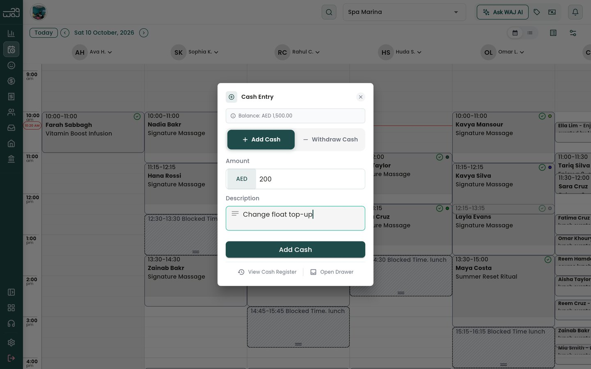
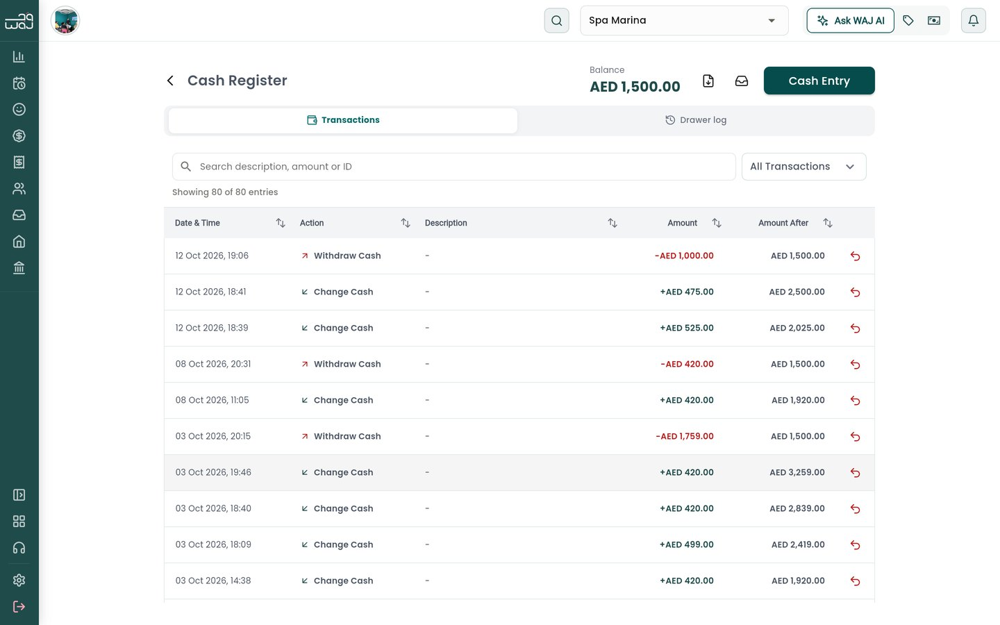
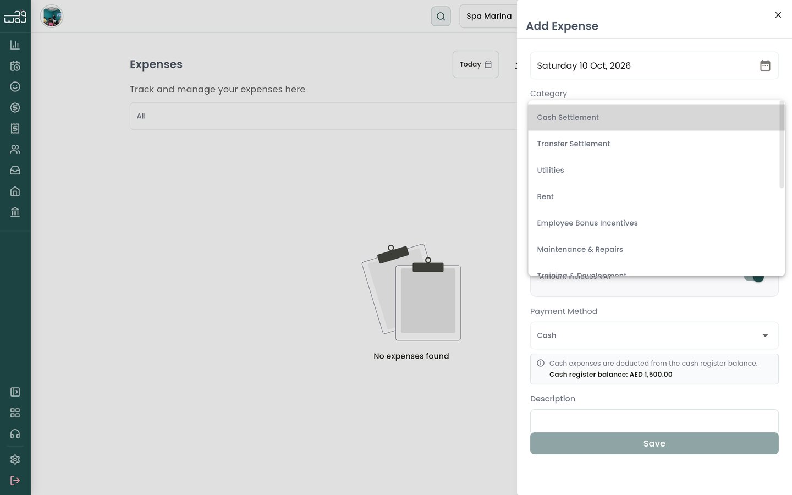
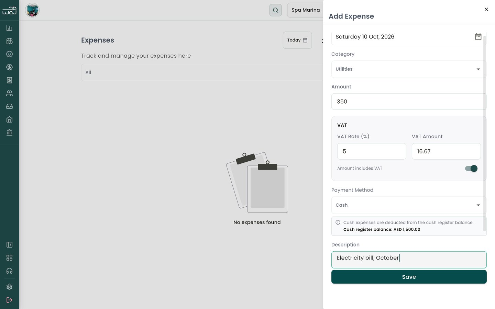
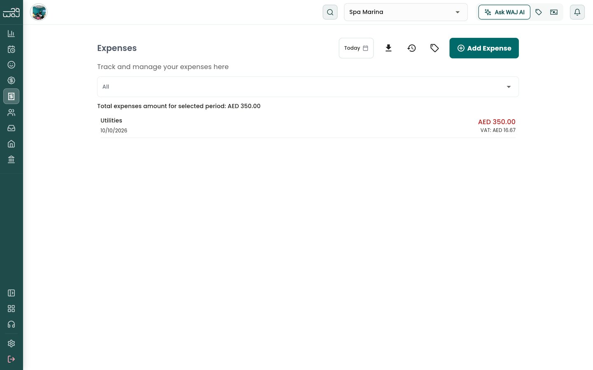
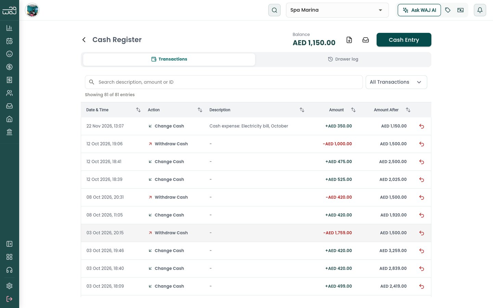

# Cash and expenses: every dirham, accounted for

[← All features](../)

▶ **Full video with sound:** [waj-cash-and-expenses.mp4](waj-cash-and-expenses.mp4) (31 s, 1920×1080)

Your cash drawer and your expenses live in one place and stay in sync. Add or take out cash in one tap, see every movement in the cash register with a running balance, and log expenses by category. Cash expenses come straight out of the drawer balance on their own.

**Where:** the cash icon in the top bar (Cash Entry and Cash Register), and **Expenses** in the sidebar · **Docs:** [Cash Register and Cash Drawer](https://waj.ai/docs/cashier-expenses/cashier-sessions) and [Expense Tracking](https://waj.ai/docs/cashier-expenses/expenses-tracking)

## How it works

### 1. Add or withdraw cash
Tap the cash icon in the top bar. You see the current balance, switch between **Add Cash** and **Withdraw Cash**, enter the amount and a short note.

### 2. See every movement
**View Cash Register** opens the full log: date and time, action, description, amount and the balance after each entry. Cash sales and cash expenses are added automatically. You can filter, export, and revert an entry if something was wrong.

### 3. Pick a category
In **Expenses**, tap **Add Expense** and pick a category: rent, utilities, maintenance, insurance, VAT payment and more, or type your own.

### 4. Amount, VAT and payment method
Enter the amount and WAJ works out the VAT for you. If you pay in cash, a note shows your current cash register balance and reminds you that the amount comes out of the drawer.

### 5. Saved and totalled
The expense shows in your list with the total for the selected period.

### 6. The drawer updates itself
A cash expense is taken off the cash register right away, with its description in the log.

## Good to know
- Only expenses paid with **Cash** change the cash register. Card and other methods never touch it.
- There is no delete in the cash register: **Revert** adds an offsetting entry, so the history stays complete.
- You can attach an invoice photo or PDF to an expense.
- Filter expenses by category and date range, and export them to CSV.
- For a daily opening and closing balance, see the End of Day report under Reports.
