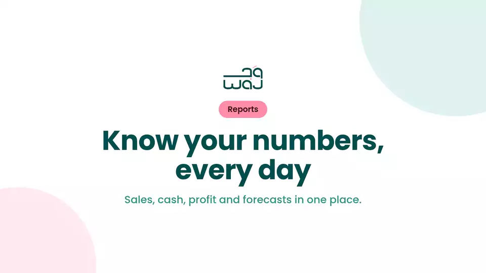
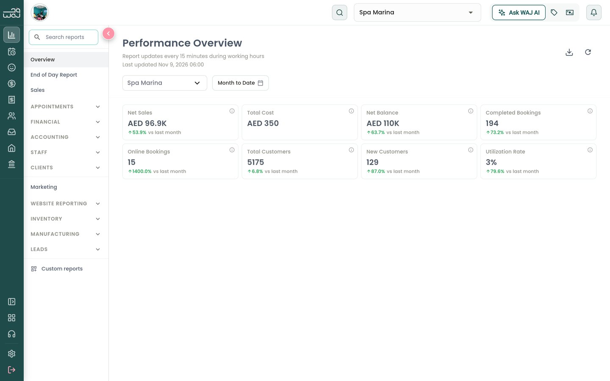
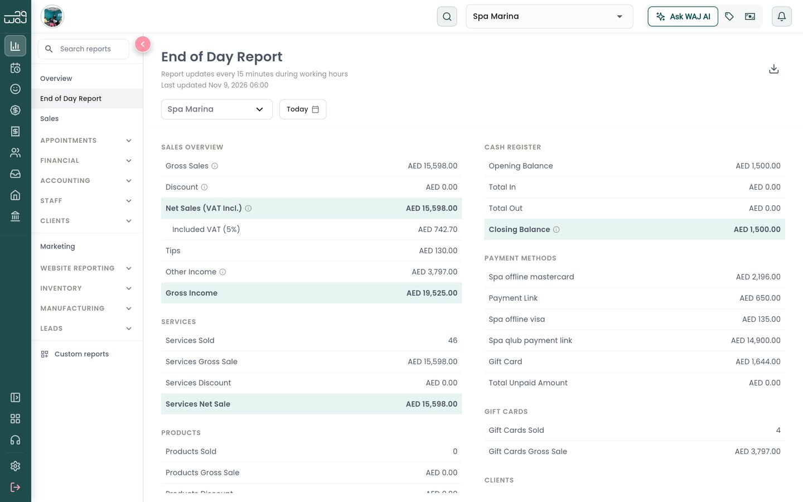
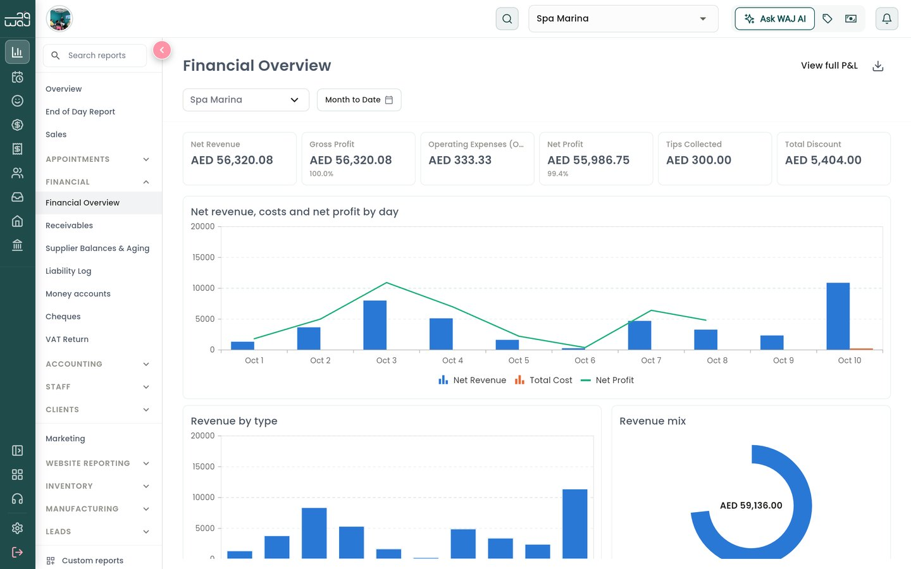
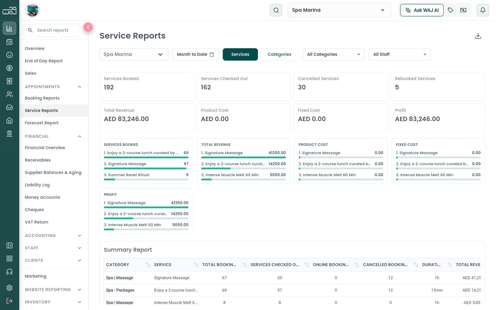
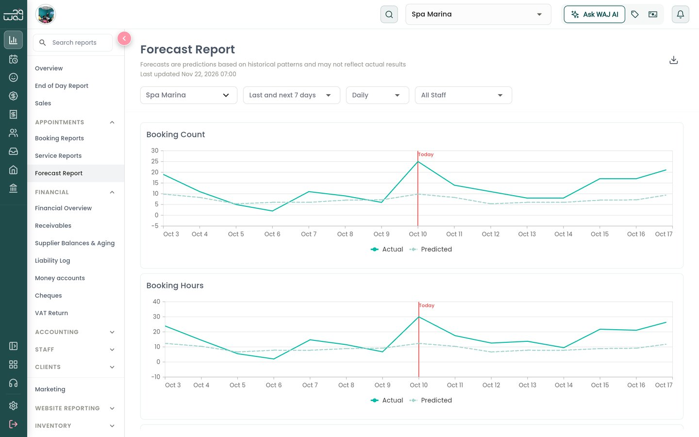

# Reports: know your numbers, every day

[← All features](../)

▶ **Full video with sound:** [waj-reports.mp4](waj-reports.mp4) (32 s, 1920×1080)

Reports is WAJ's analytics hub. One side menu takes you from a live performance overview to the end of day report, financial charts, top services and a forecast of the days ahead. Every report shares the same branch and date filters, and most can be exported.

**Where:** Reports in the left sidebar · **Docs:** [Reports Overview](https://waj.ai/docs/reports/reports-overview)

## How it works

### 1. Performance Overview
Net sales, total cost, net balance, completed and online bookings, total and new customers, and utilization, each compared with last month. It refreshes on its own every few minutes.

### 2. End of Day Report
One day for one branch: gross sales, discounts, net sales, VAT, tips and gross income, plus every payment method and the cash register from opening to closing balance. Use it to check the till before you close. See [End of Day Report](https://waj.ai/docs/reports/end-of-day-report).

### 3. Financial Overview
Net revenue, gross profit, operating expenses, net profit, tips and discounts for the period, with charts of revenue, costs and profit by day, revenue by type and the revenue mix. See [Financial Reports](https://waj.ai/docs/reports/financial-reports).

### 4. Service Reports
Services booked, checked out, cancelled and rebooked, revenue and profit, with top-three lists and a full summary table per service.

### 5. Forecast Report
Actual against predicted booking count, booking hours and booked value, before and after today, by day. See [Business Reports](https://waj.ai/docs/reports/business-reports).

## Good to know
- Pick one branch or all branches, and a date range from Today to Last Year or a custom range.
- Use the download icon to export a report as PDF, CSV or Excel.
- Some reports need report permissions. Ask your owner or manager if one is missing.
- Other sections cover appointments, accounting, staff, clients, marketing, website, inventory and leads.
