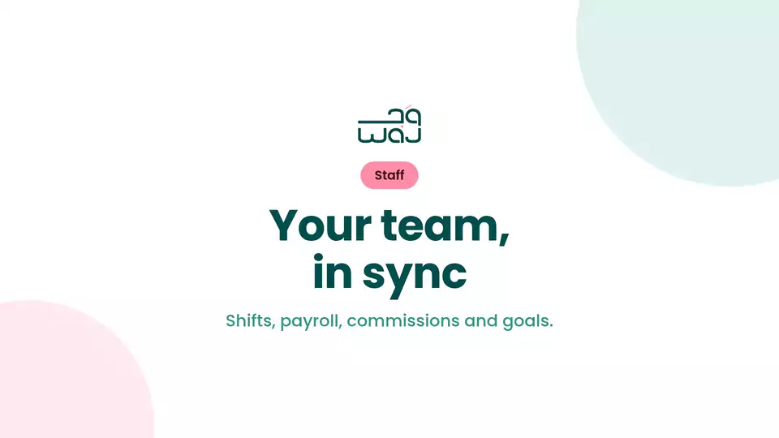
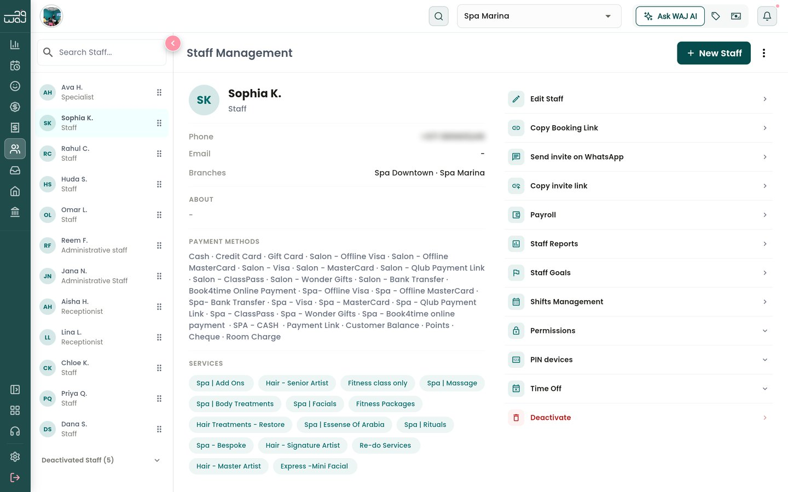
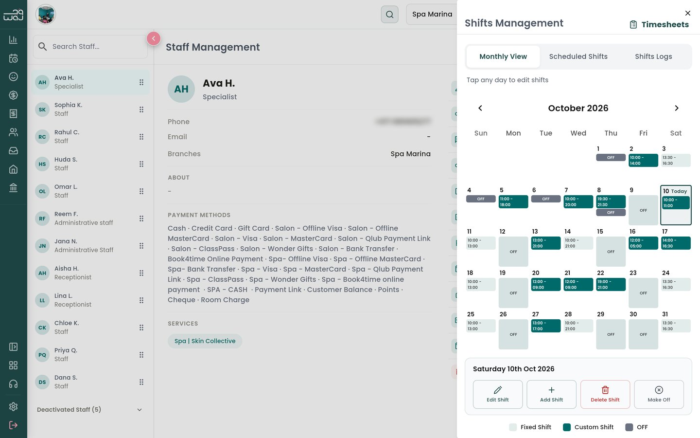
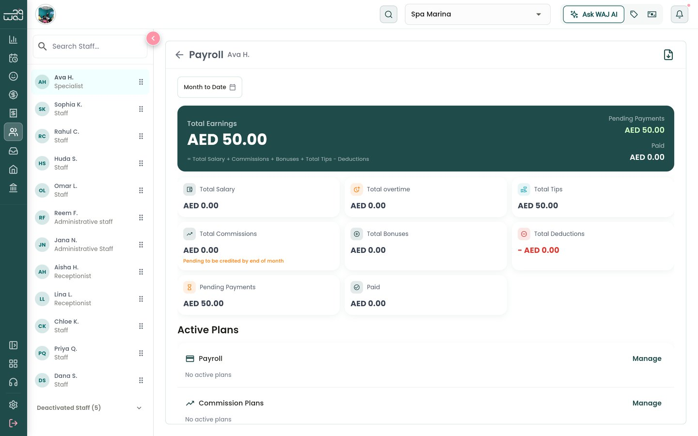
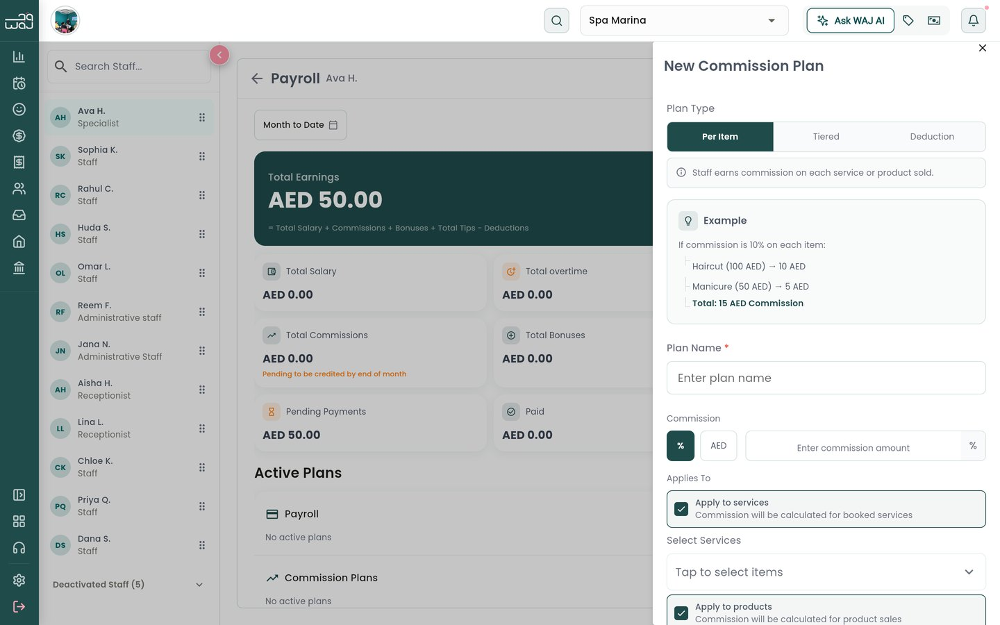
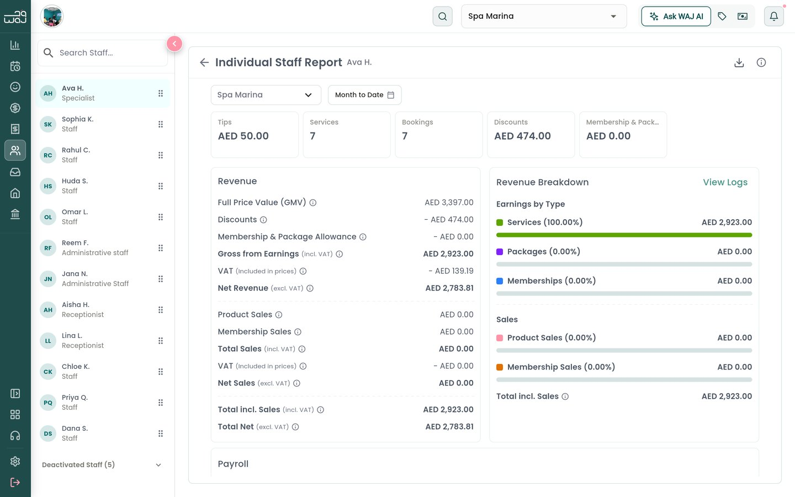
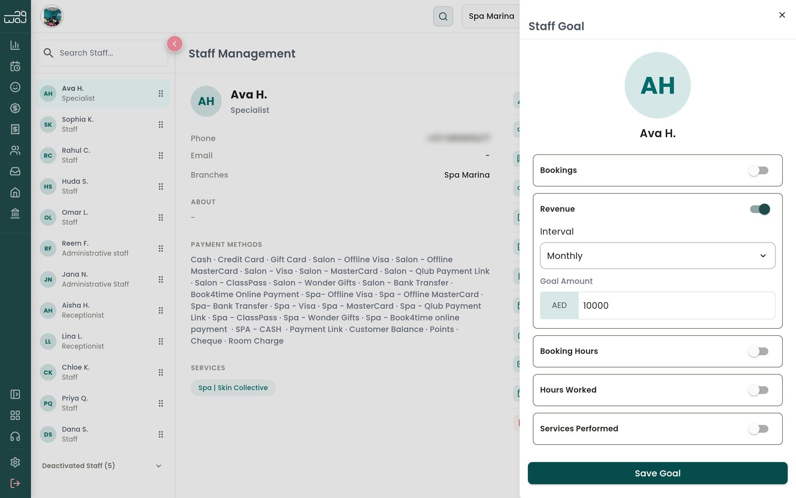

# Staff: shifts, payroll and commissions in one place

[← All features](../)

▶ **Full video with sound:** [waj-staff-payroll.mp4](waj-staff-payroll.mp4) (31 s, 1920×1080)

Staff is your team roster. Open anyone's profile to set their shifts, see their payroll in one number, set up commission plans, check their performance report and give them a goal.

**Where:** Staff in the left sidebar, then pick a team member · **Docs:** [Staff Profiles and Team Management](https://waj.ai/docs/staff/staff-profiles)

## How it works

### 1. Your team
The list shows everyone at the selected branch. Pick a person to open their profile beside the list, with their branches, payment methods, services and every action: edit, booking link, payroll, reports, goals, shifts, permissions and time off.

### 2. Shifts
Shifts Management has a monthly view to add or edit a shift on any day, a scheduled shifts tab for the weekly pattern, and shift logs of clock-ins. See [Staff Shifts and Scheduling](https://waj.ai/docs/staffshift-branch/shifts-and-scheduling).

### 3. Payroll
Total earnings = salary + commissions + bonuses + tips - deductions, with pending and paid amounts and a payslip export. See [Staff Payroll Dashboard](https://waj.ai/docs/payment/payroll).

### 4. Commission plans
Create a plan per item, tiered, or as a deduction, as a percentage or a fixed amount, for services, products or both. See [Commission Plans](https://waj.ai/docs/payment/commissions).

### 5. Staff report
Each person's tips, services, bookings and discounts, their earnings step by step from full price to net revenue, and a revenue breakdown. See [Staff Reports](https://waj.ai/docs/reports/staff-reports).

### 6. Goals
Give each person one goal at a time: revenue, bookings, booking hours, hours worked or services performed, daily, weekly or monthly. See [Staff Time Off and Goals](https://waj.ai/docs/staff/time-off-and-goals).

## Good to know
- When you save a weekly shift pattern, you can copy it to other staff at the branch.
- Approved time off blocks the person from being booked for that period.
- Commission is calculated on net service revenue: tips and VAT are never included.
- Staff phone numbers are blurred in this video and the screenshots.
