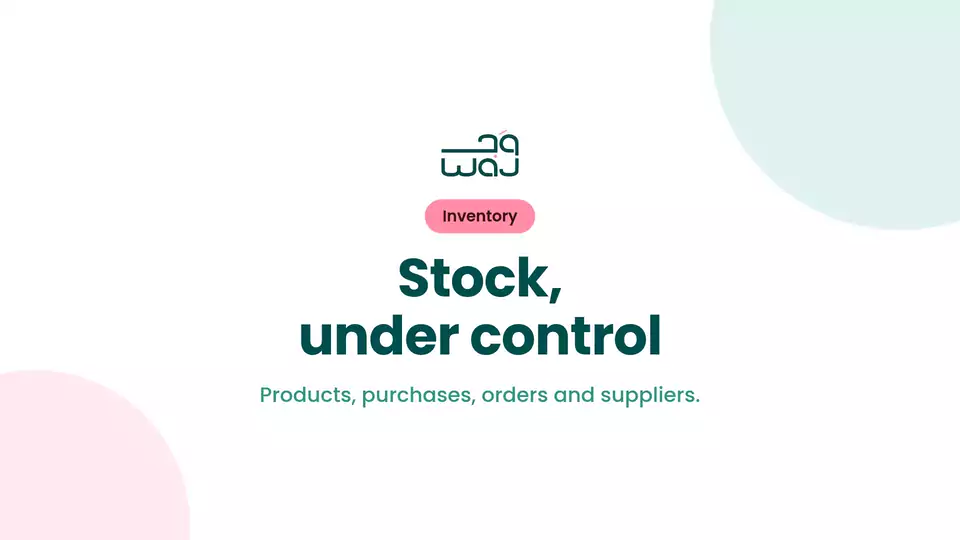
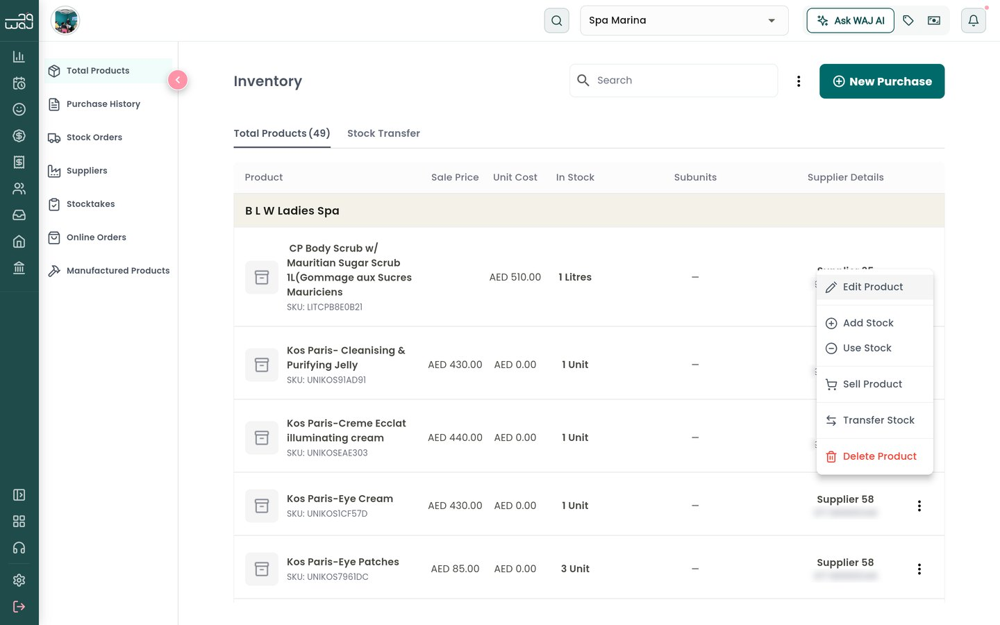
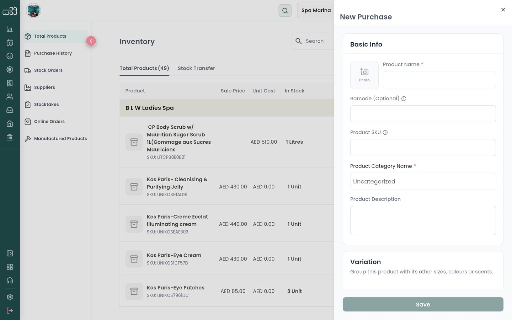
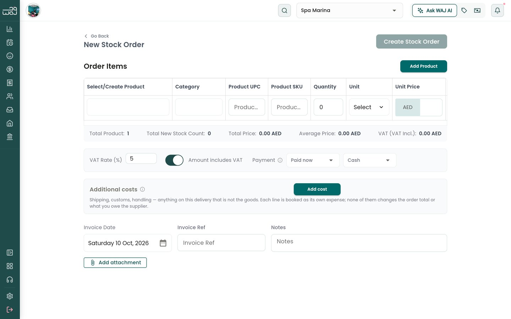
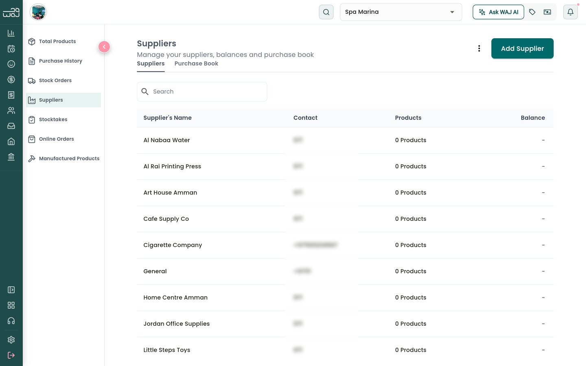
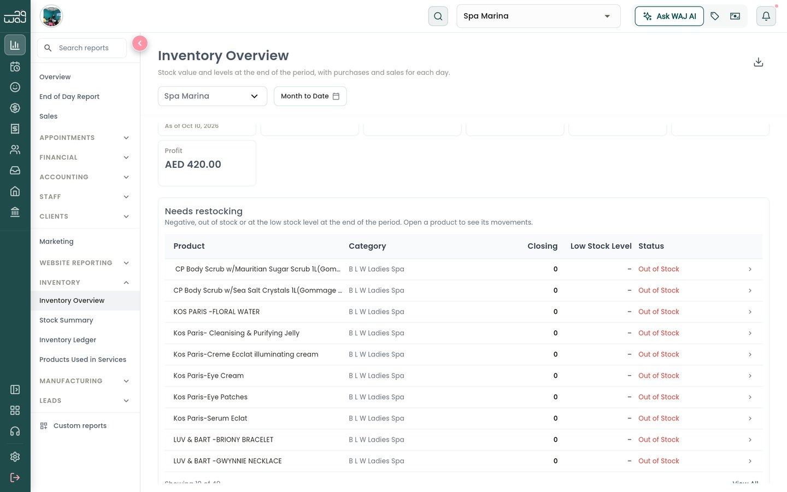

# Inventory: your stock, always in view

[← All features](../)

▶ **Full video with sound:** [waj-inventory.mp4](waj-inventory.mp4) (31 s, 1920×1080)

Inventory tracks the products you buy, stock, sell and use. See every product with its price and stock, record purchases and bulk stock orders, keep your suppliers in one place, and see what needs restocking.

**Where:** Inventory in the left sidebar · **Docs:** [Inventory Management](https://waj.ai/docs/inventory/inventory-management)

## How it works

### 1. Products and stock
Every product with its sale price, unit cost, stock and supplier, grouped by category. The menu on each product lets you edit it, add or use stock, sell it or transfer stock to another branch.

### 2. New purchase
Record a purchase for one product. It can create the product on the fly, with its photo, barcode, SKU, category and units.

### 3. Stock orders
Buy many products at once: add order lines with quantity, unit and price, set VAT and how you paid, add extra costs like shipping, and attach the invoice.

### 4. Suppliers
All your suppliers with their contact, products and balance, plus a purchase book. Suppliers are shared across branches.

### 5. Needs restocking
Reports → Inventory Overview shows inventory value, low stock, out of stock and negative stock, and lists every product that needs restocking.

## Good to know
- Recording a purchase or stock order adds to stock straight away. There is no separate approval step.
- Stock Takes let you count stock and compare it with what the system expects.
- Other inventory reports: Stock Summary, Inventory Ledger and Products Used in Services.
- Supplier phone numbers are blurred in this video and the screenshots.
