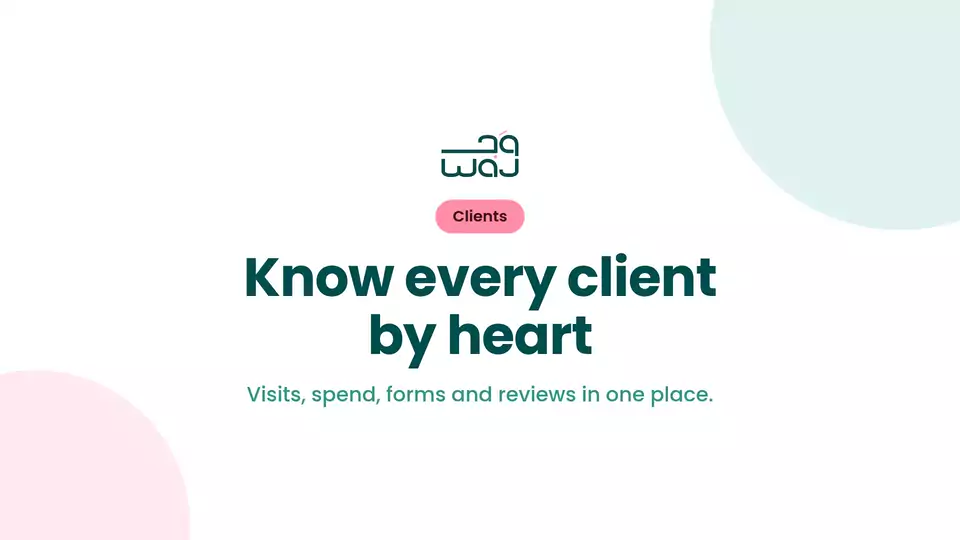
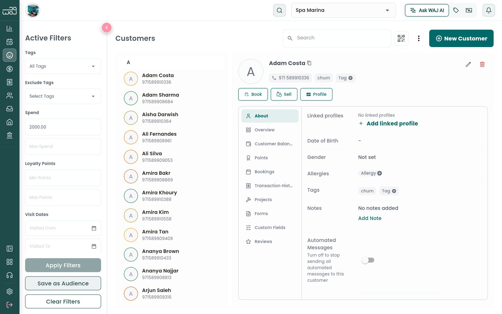
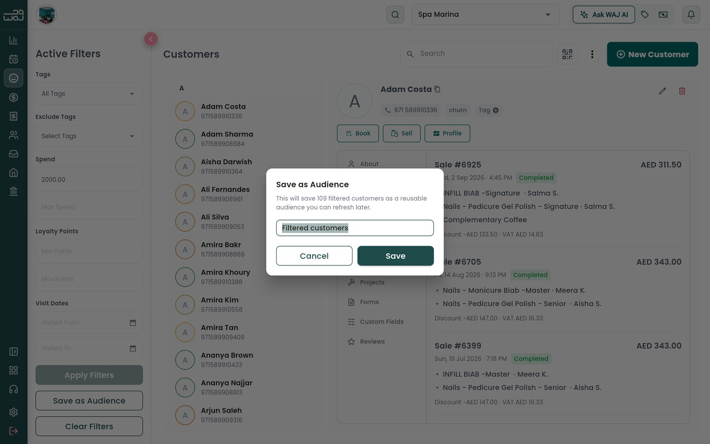
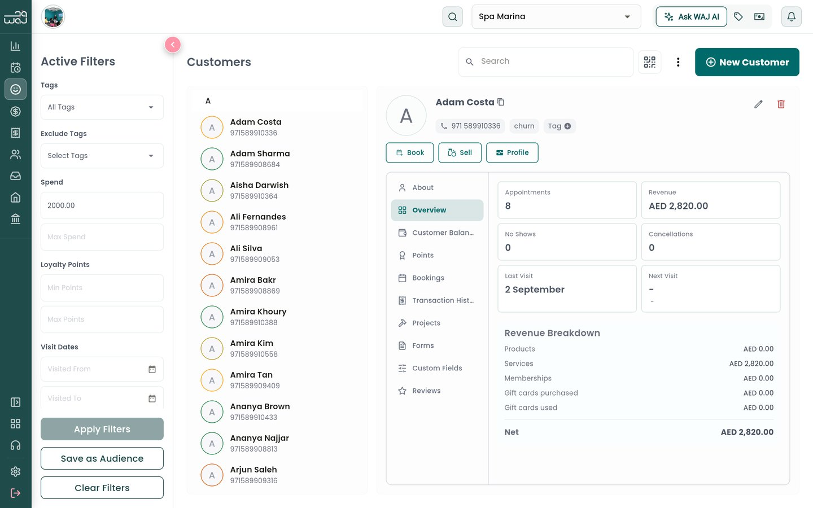
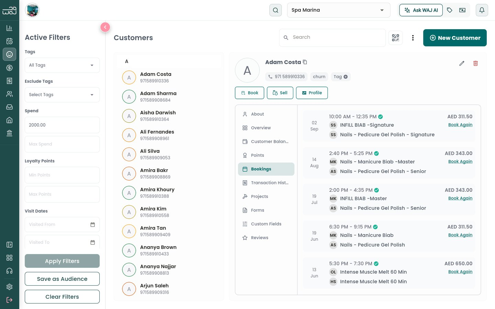
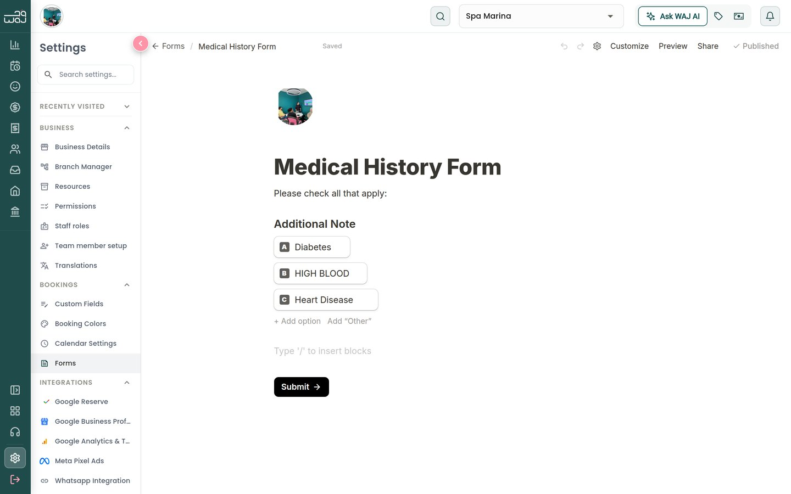
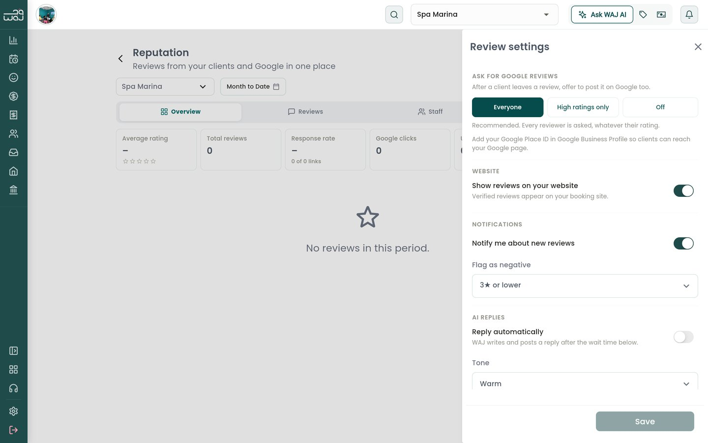

# Clients: know every client by heart

[← All features](../)

▶ **Full video with sound:** [waj-clients.mp4](waj-clients.mp4) (38 s, 1920×1080)

Every client has one profile in WAJ: their visits, spend, bookings, sales, forms and notes. Filter your list in seconds, save any filter as an audience for campaigns, and let WAJ ask happy clients for Google reviews.

**Where:** **Customers** in the side menu · **Docs:** [The Client Profile](https://waj.ai/docs/shared/client-profile), [The Client List](https://waj.ai/docs/shared/client-list-and-import), [Client Intake & Consent Forms](https://waj.ai/docs/forms-journal/intake-forms), [Customer Reviews](https://waj.ai/docs/shared/customer-reviews)

## How it works

### 1. Filter your client list
Filter by tags (or exclude tags), spend, loyalty points, visit dates, staff, branch and the services a client did or did not have. Tap **Apply Filters** and the list updates.

### 2. Save a filter as an audience
**Save as Audience** keeps the filtered clients as a reusable audience you can refresh later, ready for a campaign.

### 3. See the whole relationship
The **Overview** tab shows appointments, revenue, no-shows, cancellations, last and next visit, plus a revenue breakdown by products, services, memberships and gift cards.

### 4. Every booking, with Book again
The **Bookings** tab lists every appointment with its services, staff and total. **Book Again** starts a new booking with the same services filled in. Transaction history, balance, points, forms, custom fields and reviews each have their own tab.

### 5. Intake and consent forms
Build forms in **Settings > Forms** with a simple editor. Signed forms show on the client's **Forms** tab with the date they signed, and can be downloaded as a branded PDF.

### 6. Reviews
**Marketing > Reputation** brings reviews from your clients and Google into one place. In **Review settings** you choose who is asked to post on Google, show reviews on your website, get notified about new reviews and set up AI replies.

## Good to know
- Quick actions on every profile: **Book**, **Sell** and **Tag**.
- The **Automated Messages** toggle on the About tab stops automated messages for one client.
- Contact details, Sell and the Bookings and purchase tabs depend on staff permissions.
- Loyalty points and customer balance have their own tabs on the profile and their own docs pages.
