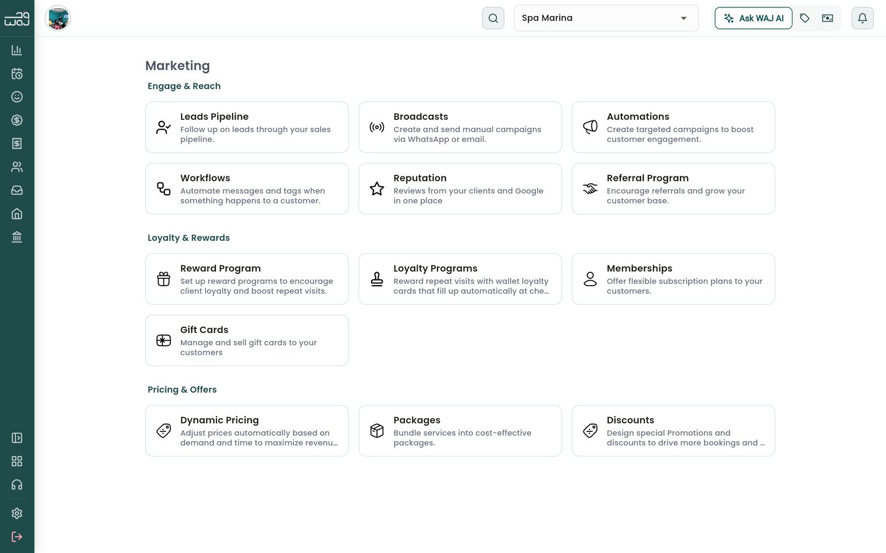
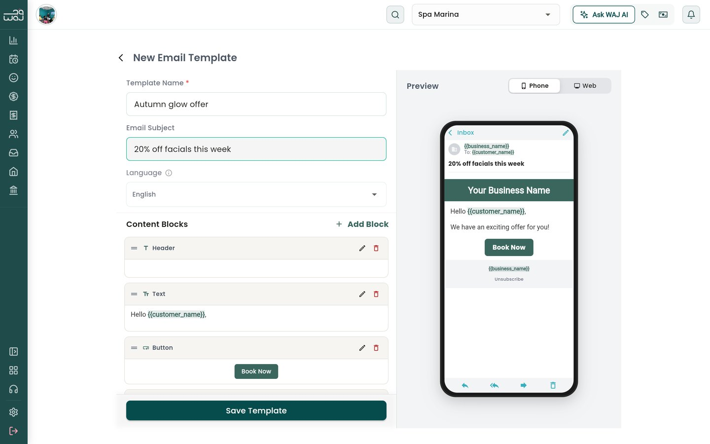
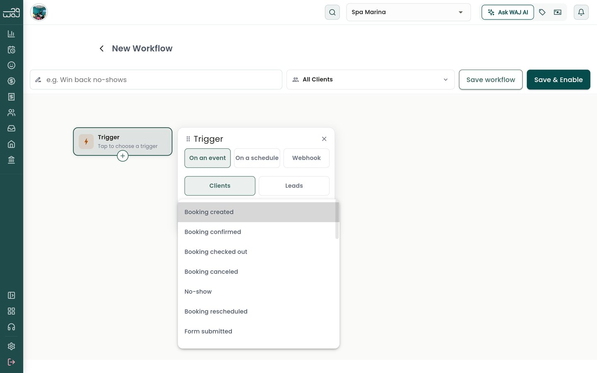
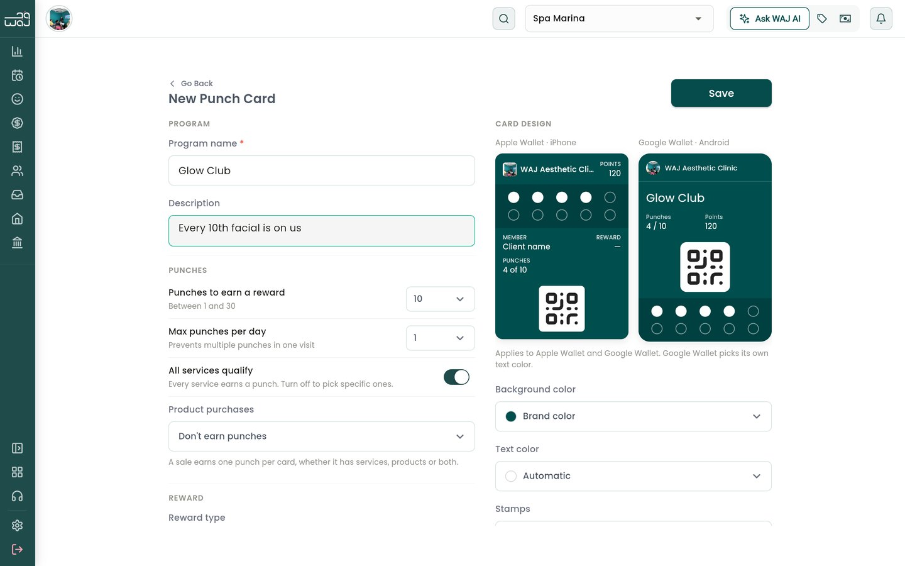
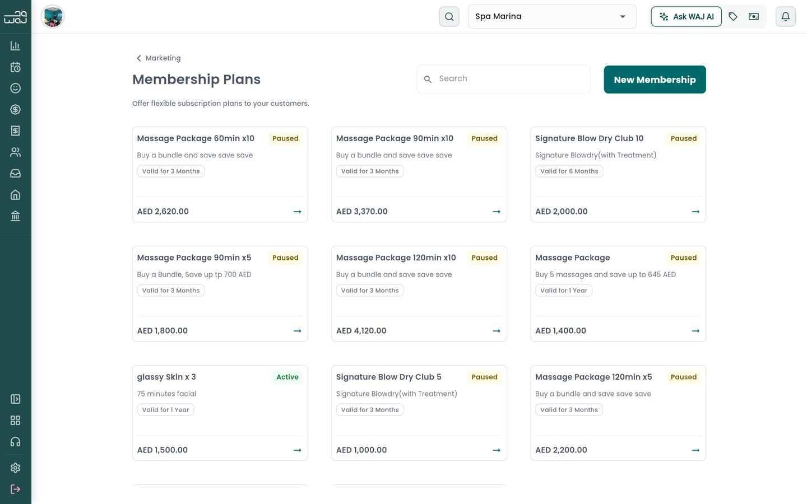

# Marketing & loyalty: bring clients back for more

[← All features](../)

▶ **Video:** [waj-marketing-loyalty.mp4](waj-marketing-loyalty.mp4) (35 s, 1920×1080)

Everything you need to win clients back lives in one Marketing hub: campaigns, automated messages, workflows, loyalty cards, reward points, referrals, memberships, packages and gift cards. Set it up once and WAJ keeps working for you.

**Where:** **Marketing** in the side menu · **Docs:** [Marketing](https://waj.ai/docs/marketing), [Broadcasts and Campaigns](https://waj.ai/docs/marketing/broadcasts-and-campaigns), [Marketing Automations](https://waj.ai/docs/marketing/automations), [Loyalty Points & Rewards](https://waj.ai/docs/marketing/loyalty-points), [Referral and Reward Programs](https://waj.ai/docs/marketing/referrals-and-rewards), [Memberships](https://waj.ai/docs/memberships/memberships), [Packages, Flash Sales & Promotion Codes](https://waj.ai/docs/discounts-giftcards/packages-and-offers)

## How it works

### 1. One hub for growth
The Marketing page groups your tools into Engage & Reach, Loyalty & Rewards, and Pricing & Offers.

### 2. Campaigns
**Broadcasts > New Campaign** walks you through six steps: channel, template, content, audience, schedule and review. Send by WhatsApp (once your number is connected) or email. The email template editor shows a live phone and web preview as you type.

### 3. Automations and workflows
**Automations** has ready-made messages you switch on per channel: booking confirmation, cancellation, reminder, aftercare, rescheduling, no-show, welcome, loyalty points, birthdays and churn prevention. **Workflows** let you build your own rule: pick a trigger (an event, a schedule or a webhook), then add steps.

### 4. Loyalty cards and reward points
**Loyalty Programs** creates punch cards for Apple Wallet and Google Wallet. Choose the punches needed, which services count and the reward, and see the card preview update as you type. The **Reward Program** gives clients points on every completed sale (1% cashback by default) to redeem at checkout. The **Referral Program** gives a discount to the client who refers and to the new client.

### 5. Memberships, packages and gift cards
Sell membership plans, bundle services into packages, run flash sales and promotion codes, and sell gift cards.

## Good to know
- The last campaign step is Review, so you check everything before it goes out. Broadcasts shows your messaging credit balance.
- Automations can be switched on separately for WhatsApp and email, and for local and online bookings.
- Points are reversed automatically if a sale is voided or refunded.
