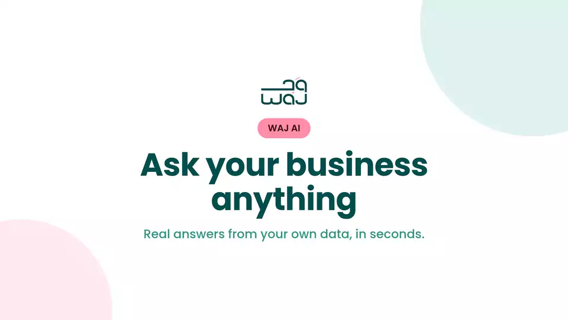
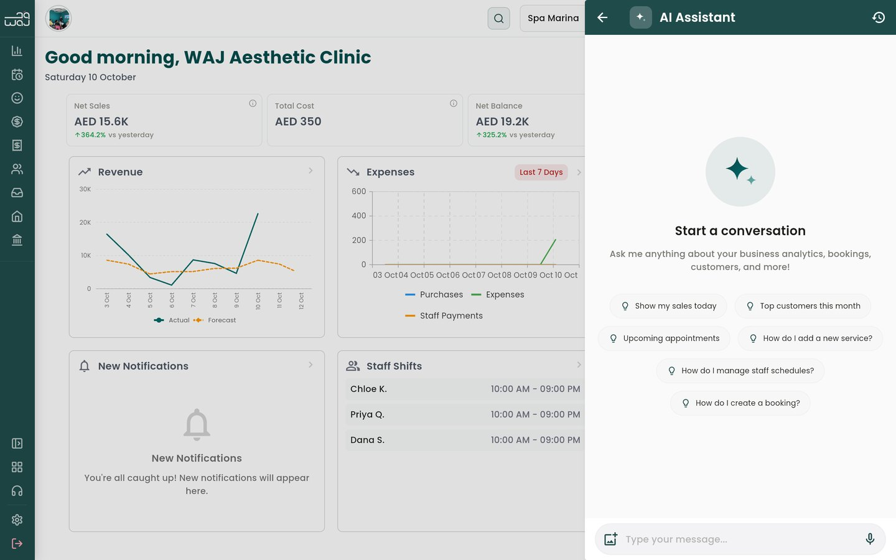
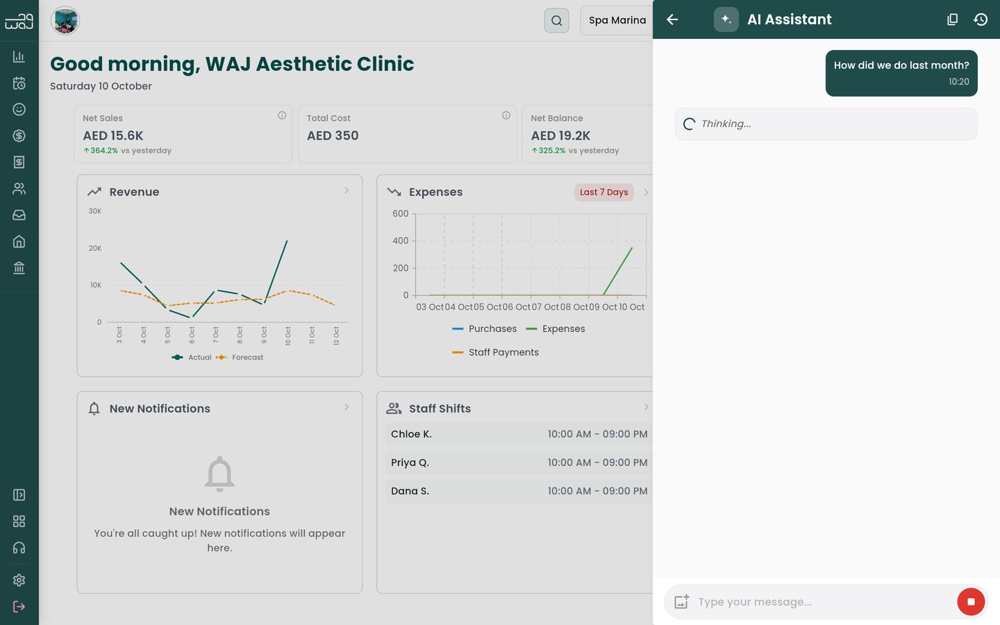
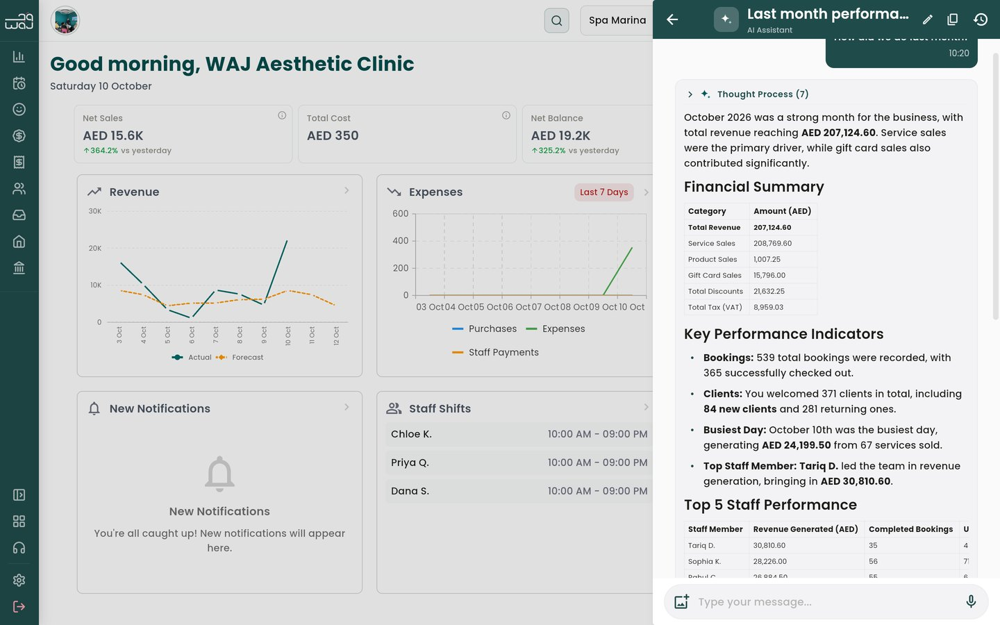
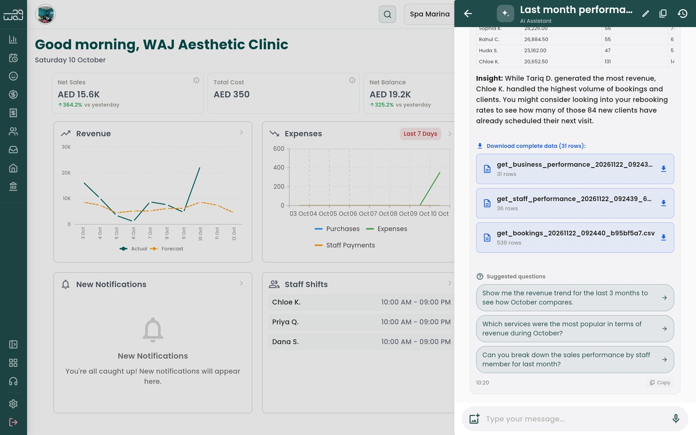
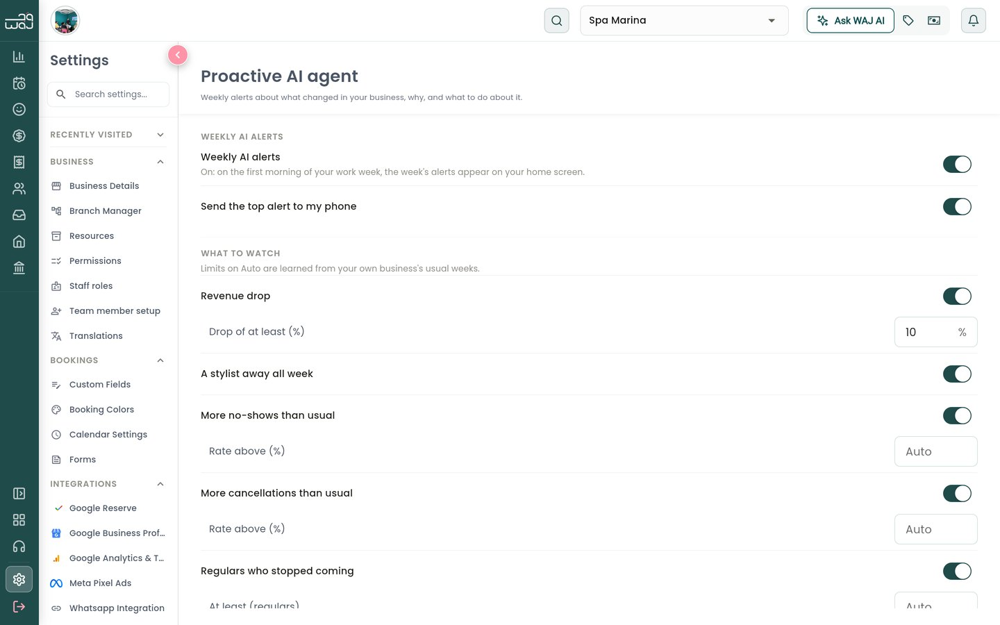

# WAJ AI assistant: ask your business anything

[← All features](../)

▶ **Full video with sound:** [waj-ai-assistant.mp4](waj-ai-assistant.mp4) (32 s, 1920×1080)

The AI Assistant is built into WAJ. Ask a question in plain words, like "How did we do last month?", and it looks up your real business data and answers with numbers and tables in seconds. It can also walk you through how to use WAJ, and the Proactive AI agent sends you weekly alerts about what changed.

**Where:** **Ask WAJ AI** in the top bar · **Docs:** [AI Assistant](https://waj.ai/docs/ai-features/ai-assistant), [AI Features](https://waj.ai/docs/ai-features)

## How it works

### 1. Open it from anywhere
Tap **Ask WAJ AI** in the top bar. The assistant opens as a side panel over whatever you were doing, with suggested questions to start, such as "Show my sales today" or "How do I create a booking?".

### 2. Ask in plain words
Type your question (or use the microphone) and send it. A short "thinking" step shows the assistant looking up your data.

### 3. Get real numbers
The answer streams in with a summary, tables and key numbers: revenue, bookings, new and returning clients, the busiest day and top staff.

### 4. Dig deeper
Download the full data behind an answer as a file, or tap a suggested follow-up question. Chats are saved in **Chat History**, where you can rename or delete them.

### 5. Weekly AI alerts
**Settings > Proactive AI agent** sends weekly alerts about what changed in your business, why, and what to do about it: revenue drops, a stylist away all week, more no-shows or cancellations than usual, regulars who stopped coming, empty slots next week, unpaid sales and more. You choose what to watch and can send the top alert to your phone.

## Good to know
- What each staff member can ask about depends on their permission level.
- "How do I..." questions are answered from the WAJ Help Center.
- More AI in WAJ: AI replies in the inbox, AI recommendations on bookings and sales, AI review replies, the voice agent, and AI connectors for Claude and ChatGPT (each has its own video or docs page).
