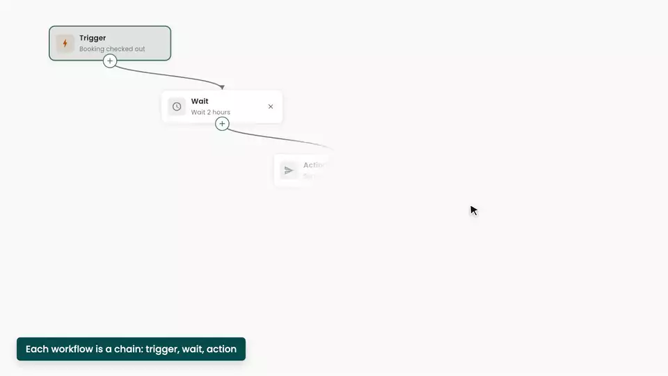
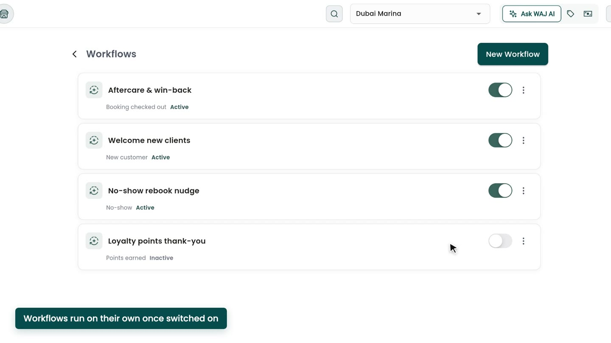
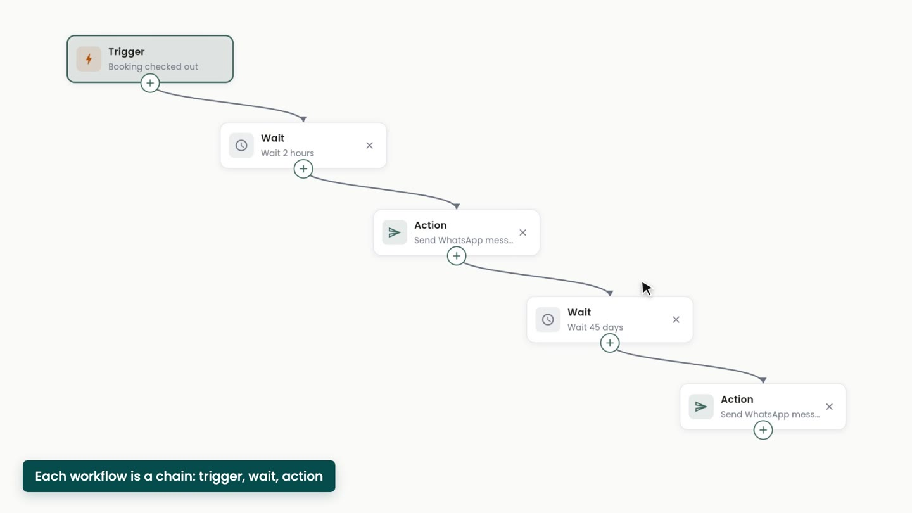
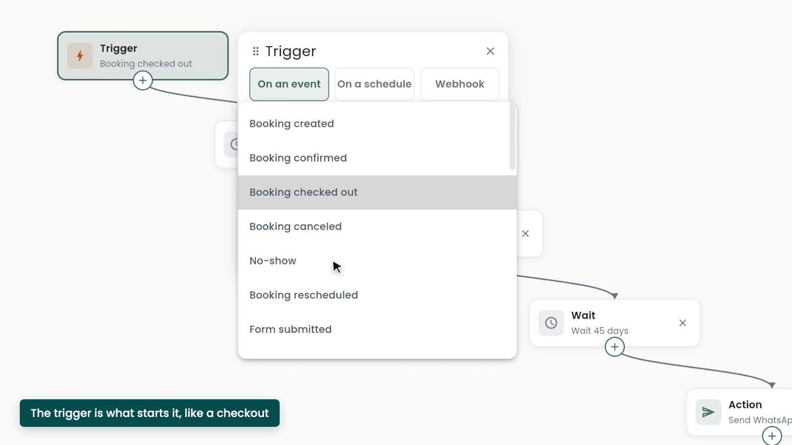
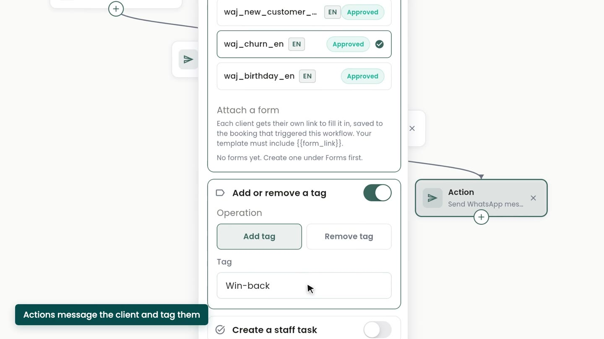

# Marketing workflows: follow-ups that run themselves

[← All features](../)

▶ **Full video with sound:** [waj-marketing-workflows.mp4](waj-marketing-workflows.mp4) (14 s, 1920×1080, no sound)

Workflows send the right message at the right moment without you lifting a finger. Each one is a simple chain: a trigger, a wait, then actions. Switch a workflow on and it runs by itself.

**Where:** Marketing › Workflows · **Docs:** [Marketing Automations](https://waj.ai/docs/marketing/automations)

## How it works

### Ready-made workflows
Aftercare and win-back, welcome new clients, no-show rebook nudge and loyalty points thank-you. Turn each one on or off with a switch.

### Trigger, wait, action
Every workflow is a chain you can read at a glance.

### Pick what starts it
Start on an event (a booking is created, confirmed, checked out, cancelled or a no-show, a form is submitted), on a schedule, or from a webhook.

### Message the client and tag them
Actions send an approved WhatsApp template, attach a form, add or remove a tag, or create a task for your team.

