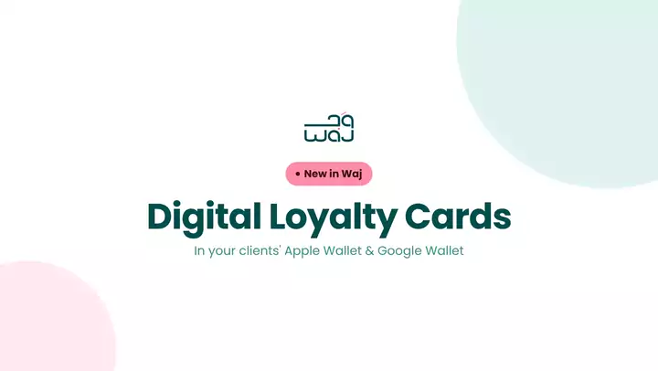
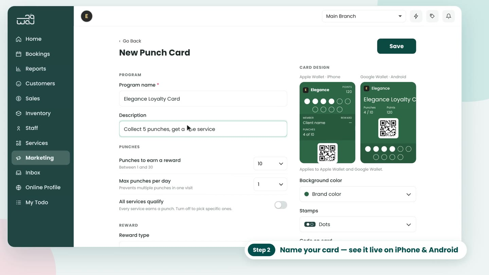
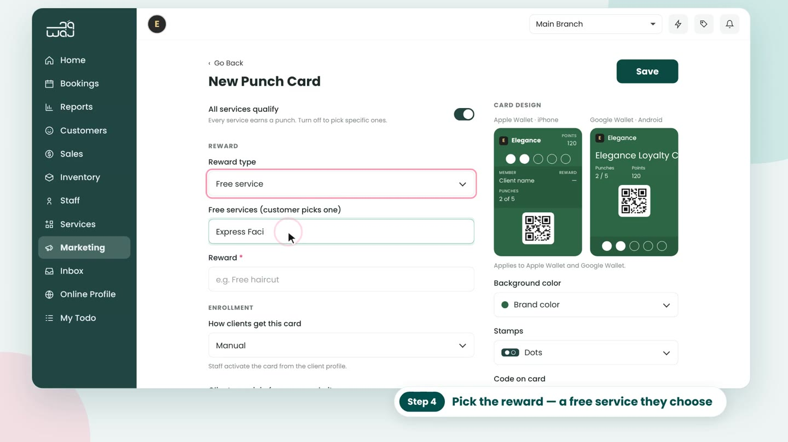
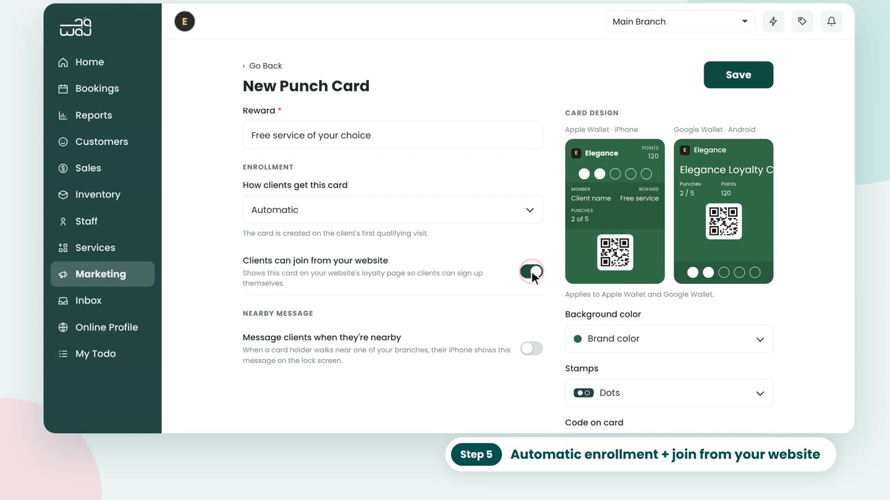
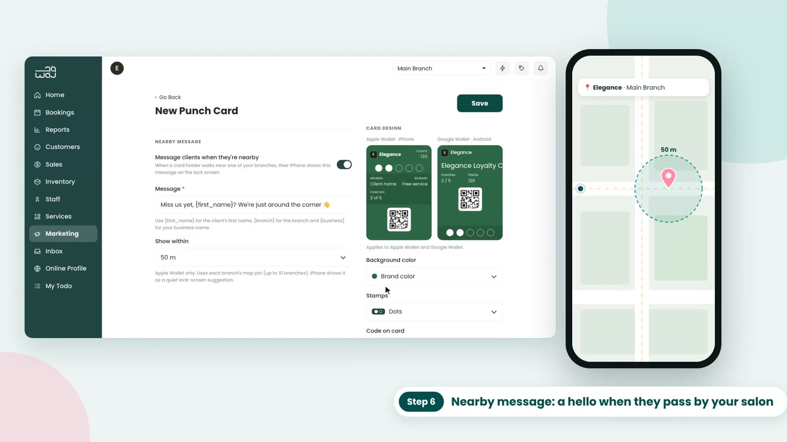
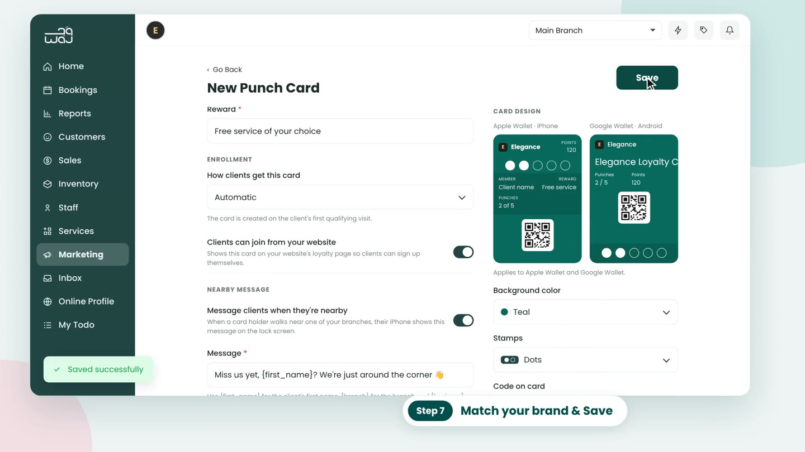

# Loyalty cards: in your clients' Apple Wallet and Google Wallet

[← All features](../)

▶ **Full video with sound:** [waj-loyalty-cards.mp4](waj-loyalty-cards.mp4) (83 s, 1920×1080)

Digital punch cards that live in your clients' Apple Wallet and Google Wallet. Repeat visits are rewarded automatically: no paper cards and no app to download.

**Where:** Marketing › Loyalty Programs › New Program · **Docs:** [Loyalty Points & Rewards Program](https://waj.ai/docs/marketing/loyalty-points)

## How it works

### Name your card
Give it a name and a short description. The live preview shows exactly how it looks on iPhone and Android.

### Pick the reward
Choose how many punches earn a reward, limit it to one punch per day, and pick the reward, for example a free service the client chooses from your list.

### Automatic enrollment
The card is created on the client's first visit. Clients can also join from your website.

### Nearby messages
When a card holder walks past your branch, your message appears on their lock screen.

### Match your brand
Choose colours and stamps and save. You can then message every card holder at once, straight to their lock screen.

