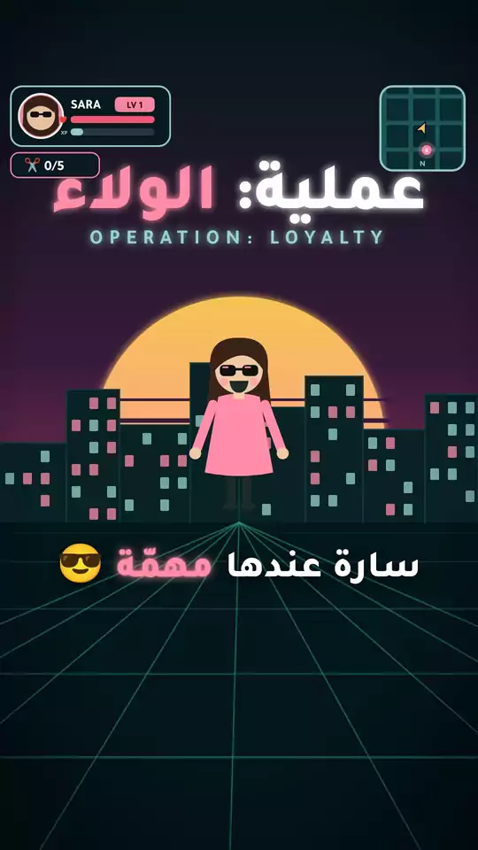
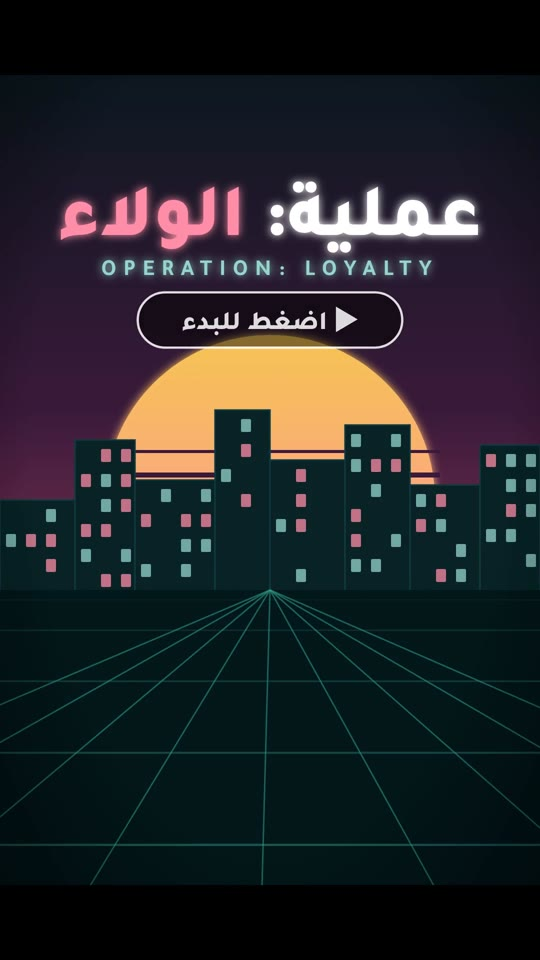
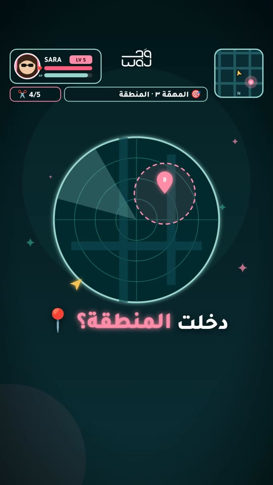
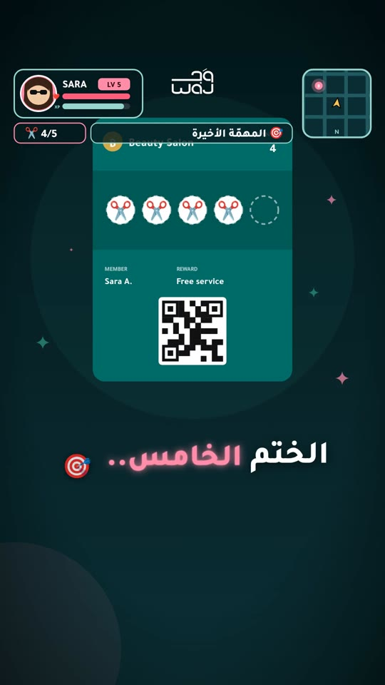
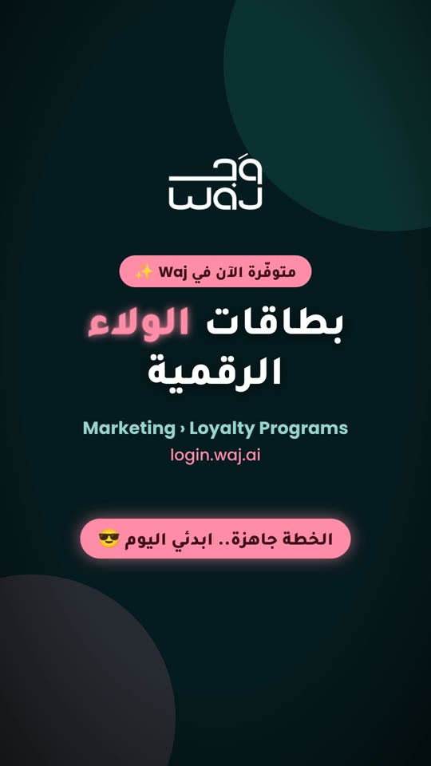

# Operation Loyalty: digital loyalty cards (Arabic)

[← All features](../)

▶ **Full video with sound:** [waj-loyalty-game-ar.mp4](waj-loyalty-game-ar.mp4) (32 s, 1080×1920 vertical, Arabic voiceover)

A playful, game-style video in Arabic for Stories and Reels. Sara's mission: swap paper cards for a digital loyalty card that collects a stamp on every visit, reminds her when she's nearby, and unlocks a free service on the fifth stamp.

**Where:** Marketing › Loyalty Programs · **Docs:** [Loyalty Points & Rewards Program](https://waj.ai/docs/marketing/loyalty-points)

## Scenes

| | | | |
|---|---|---|---|
|  |  |  |  |
| Operation Loyalty | A reminder when she's nearby | The fifth stamp: a free service | Available now in WAJ |

See [Loyalty cards](../14-loyalty-cards/) for the English walkthrough.
