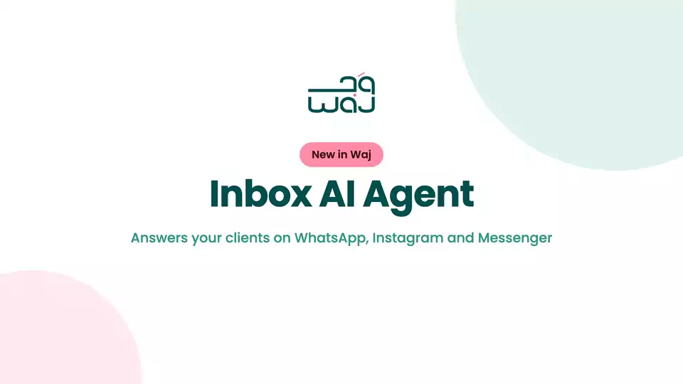
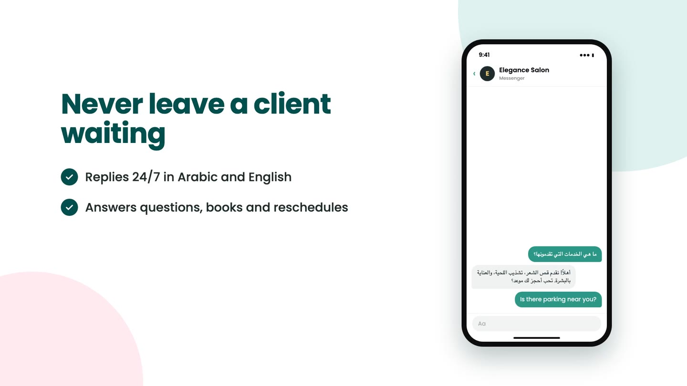
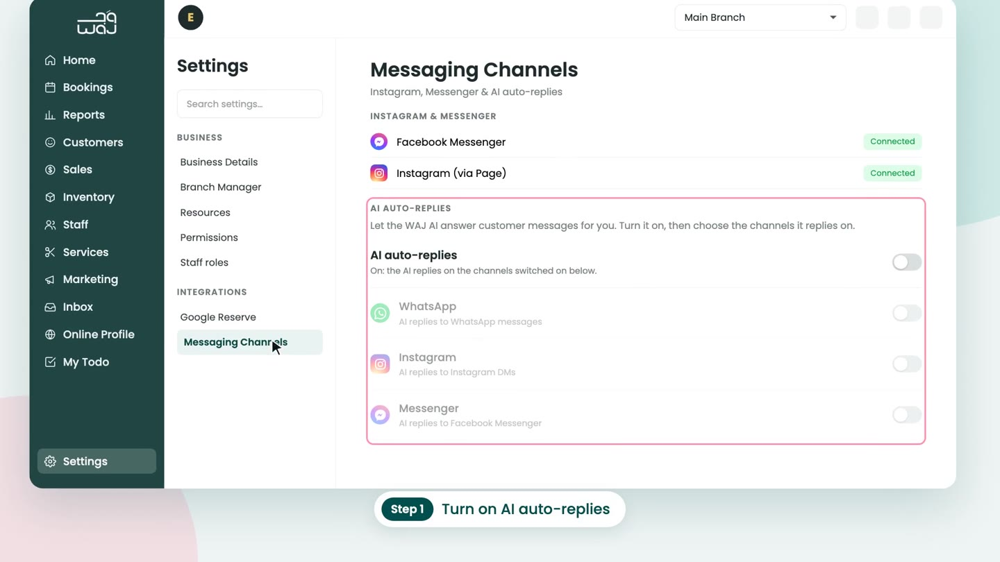
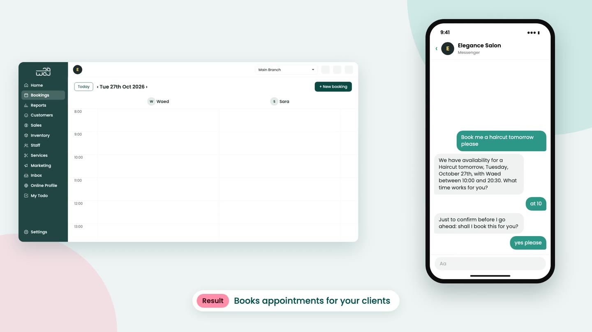
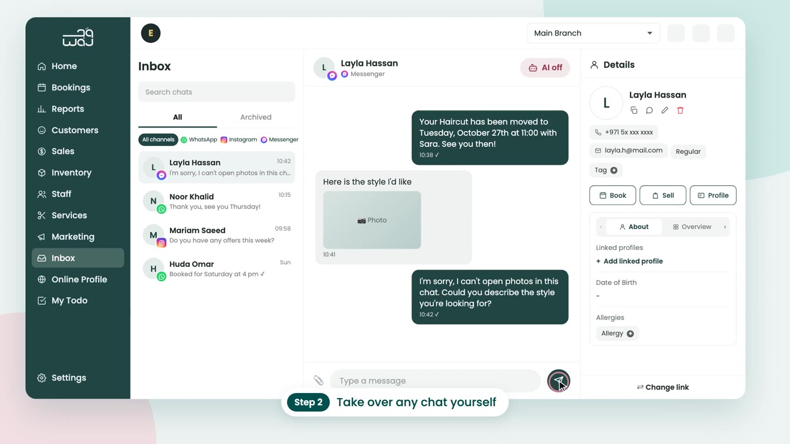

# Inbox AI agent: never leave a client waiting

[← All features](../)

▶ **Full video with sound:** [waj-inbox-ai-agent.mp4](waj-inbox-ai-agent.mp4) (44 s, 1920×1080)

The inbox AI agent answers your clients on WhatsApp, Instagram and Messenger, day and night, in Arabic and English. It answers questions, books and reschedules appointments, and you can take over any chat yourself.

**Where:** Settings › Messaging Channels · **Docs:** [Unified Inbox](https://waj.ai/docs/marketing/unified-inbox)

## How it works

### Replies 24/7
Clients get an answer in seconds, in their language.

### Turn on AI auto-replies
Open Settings › Messaging Channels, turn on AI auto-replies and pick your channels.

### It books for you
When a client asks for an appointment, the agent checks availability, confirms and puts the booking in your calendar.

### Take over any chat
Switch the AI off for a single conversation (AI on becomes AI off) and reply yourself.

