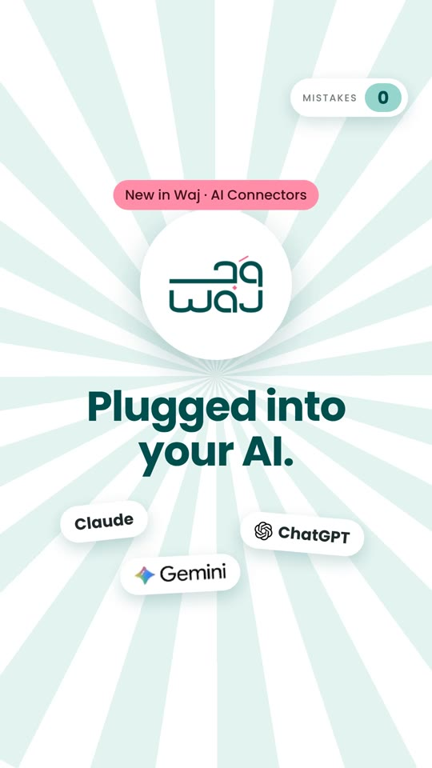
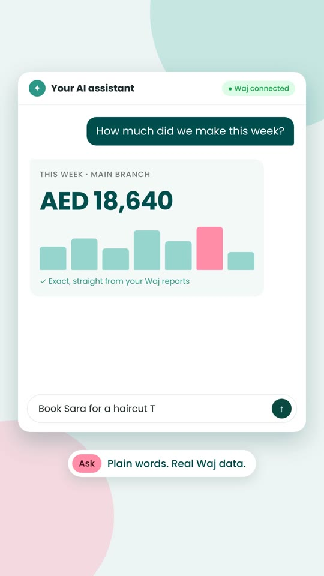
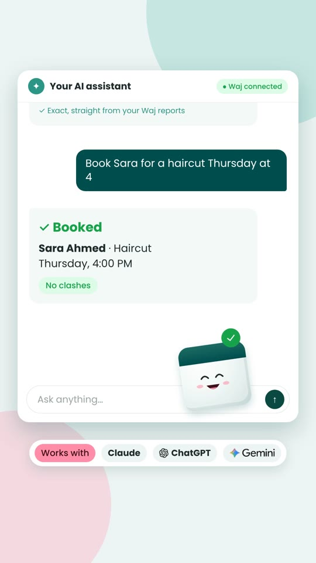
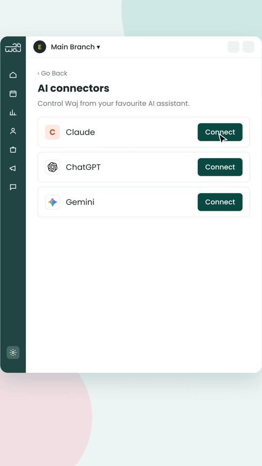

# AI connectors: run WAJ from Claude, ChatGPT or Gemini

[← All features](../)

▶ **Full video with sound:** [waj-ai-connectors-vertical.mp4](waj-ai-connectors-vertical.mp4) (38 s, 1080×1920 vertical)

Plug WAJ into the AI assistant you already use. Ask how much you made this week and get the exact number, or tell it to book a client on Thursday at 4 and it's done, with no clashes. Fewer manual mistakes for your team.

**Where:** Settings › AI Connectors › Connect · **Docs:** [AI connectors](https://waj.ai/docs/ai-features/ai-connectors)

## Scenes

| | | | |
|---|---|---|---|
|  |  |  |  |
| Works with Claude, ChatGPT and Gemini | Ask for exact numbers | Book by asking | Settings › AI Connectors |
