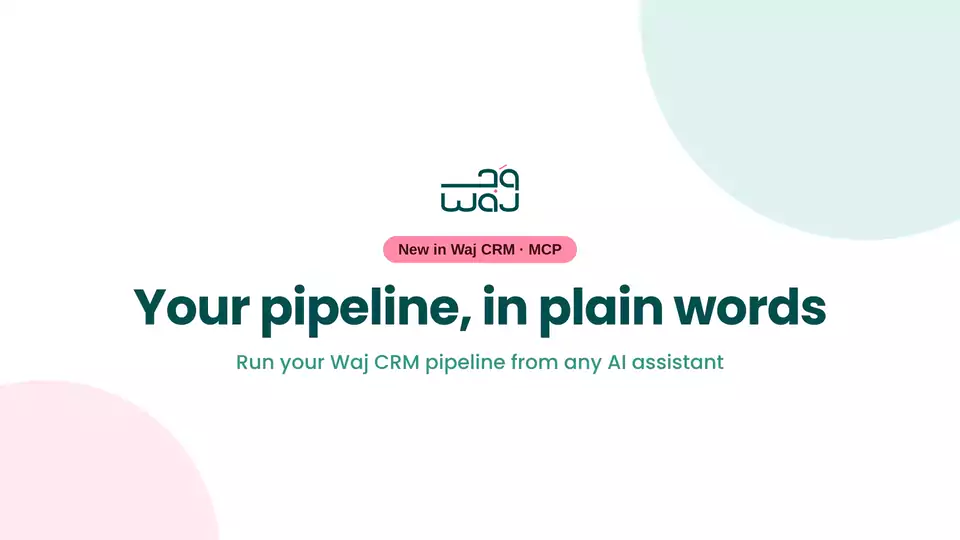
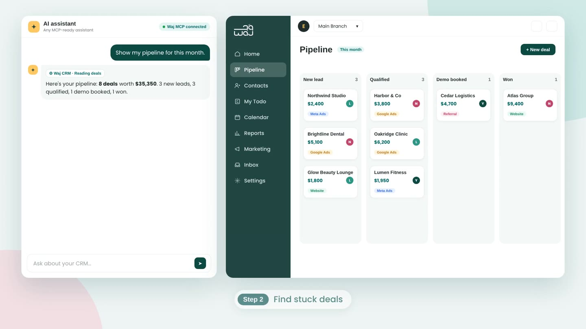
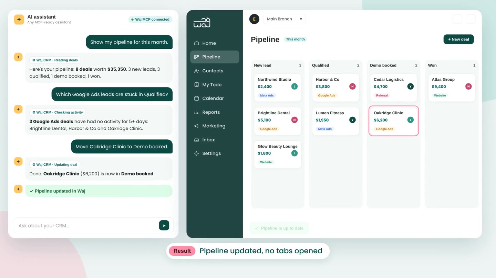
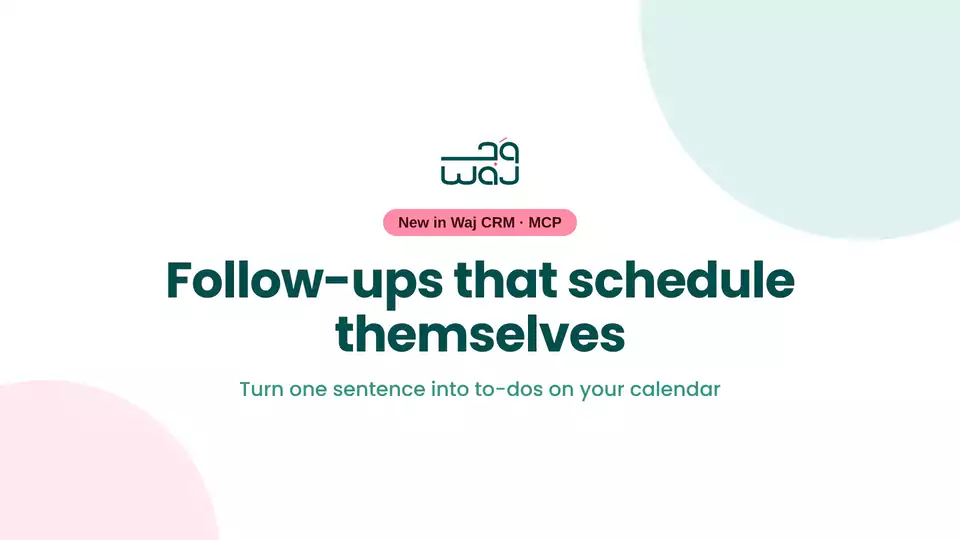
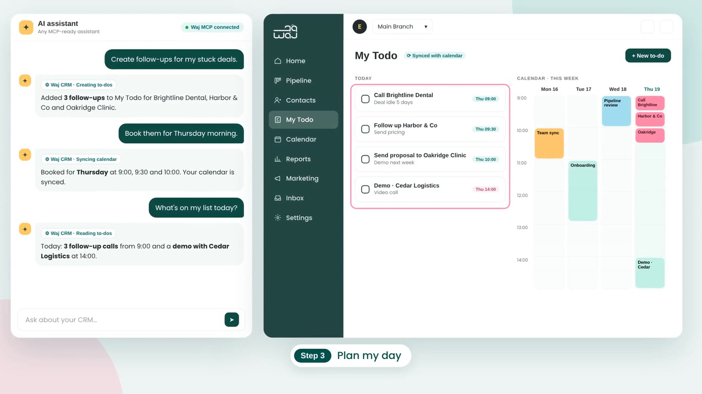
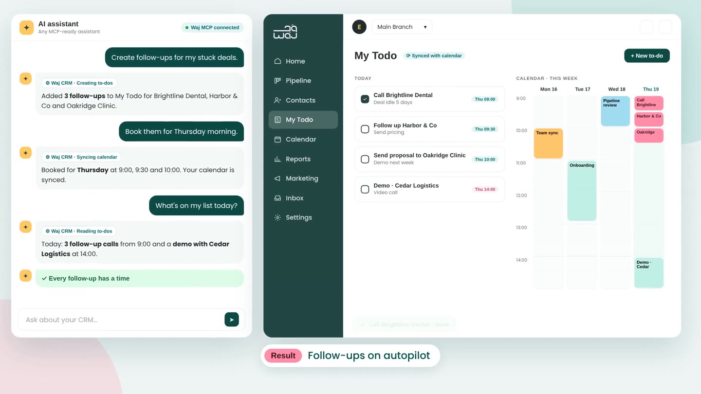
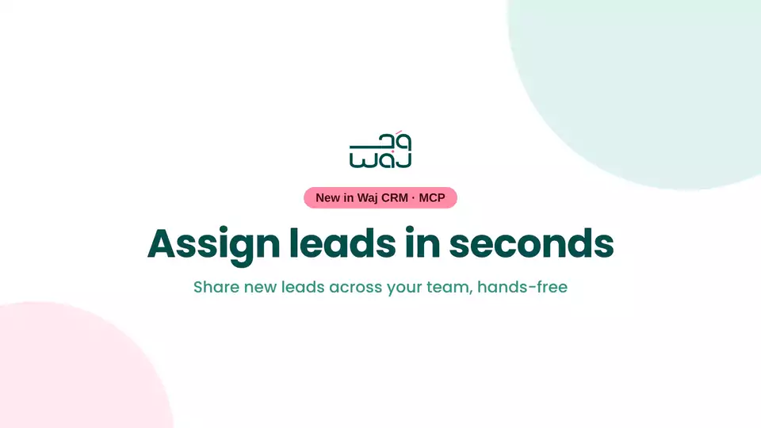
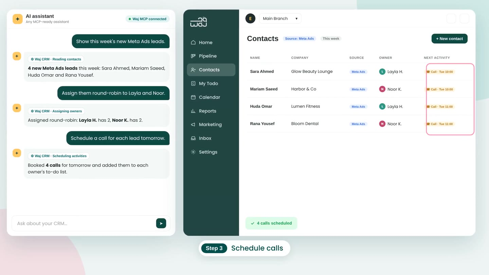
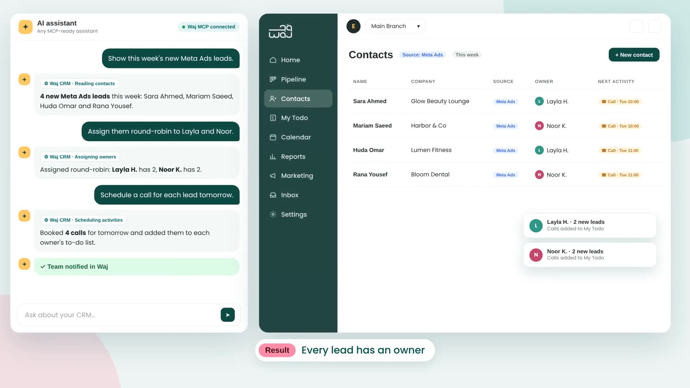

# WAJ CRM with your AI: your pipeline, in plain words

[← All features](../)

▶ **Full video with sound:** [waj-crm-ai-pipeline.mp4](waj-crm-ai-pipeline.mp4) (50 s, 1920×1080) · two more below

Run your WAJ CRM from any AI assistant that supports MCP. Ask in plain words and your assistant works with live WAJ data: no switching tabs. Three short videos show the pipeline, follow-ups and lead assignment.

**Where:** connect your AI in Settings › AI Connectors · **Docs:** [AI connectors](https://waj.ai/docs/ai-features/ai-connectors)

## 1. Your pipeline, in plain words
Ask to see your pipeline and every deal appears by stage with its value and lead source. Ask which leads are stuck, then move a deal to the next stage. The card moves in WAJ instantly.

## 2. Follow-ups that schedule themselves
▶ [waj-crm-ai-follow-ups.mp4](waj-crm-ai-follow-ups.mp4) (50 s)

One sentence creates follow-up to-dos for stuck deals, books them on your calendar, and gives you a short plan for the day.

## 3. Assign leads in seconds
▶ [waj-crm-ai-assign-leads.mp4](waj-crm-ai-assign-leads.mp4) (49 s)

List this week's new ad leads, share them round-robin across your team and schedule a call for each. Every lead gets an owner and a next step.

