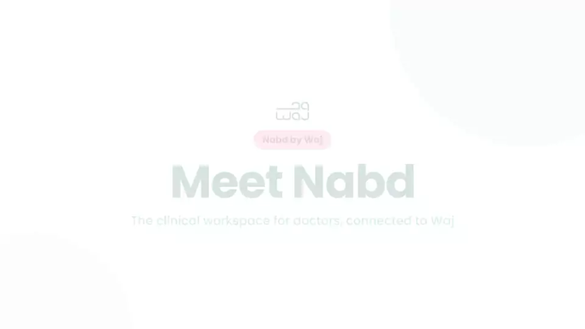
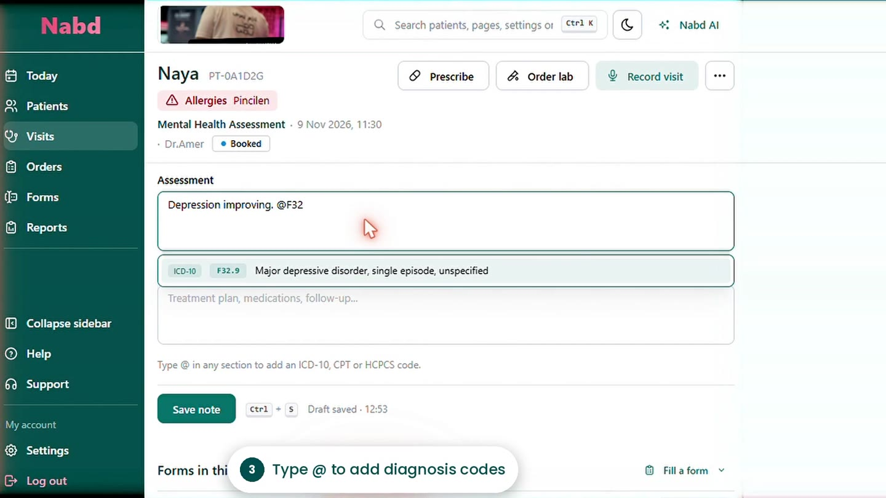
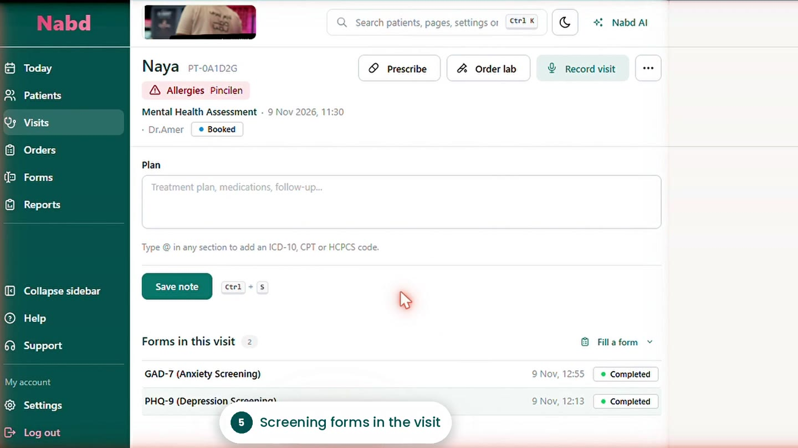
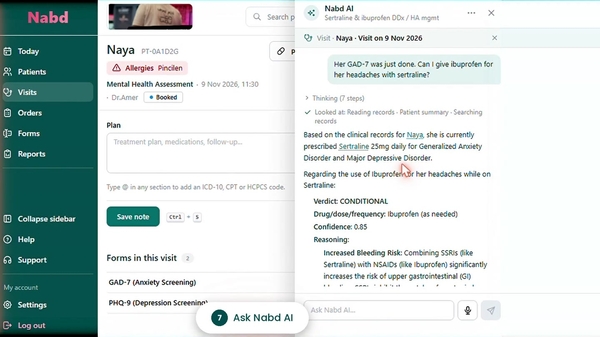
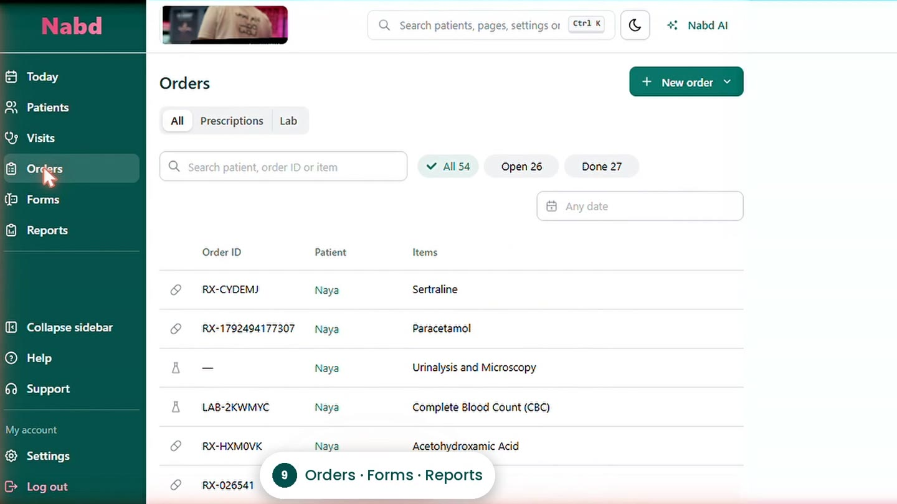

# WAJ Nabd: smarter visits, less paperwork

[← All features](../)

▶ **Full video with sound:** [nabd-by-waj.mp4](nabd-by-waj.mp4) (53 s, 1920×1080)

Nabd is the clinical workspace for doctors, connected to WAJ. Open today's visit in one click, write notes, add diagnosis codes, run screening forms, prescribe with interaction checks and ask Nabd AI about the patient's chart.

**Where:** [nabd.waj.ai](https://nabd.waj.ai) · **Docs:** [WAJ Nabd](https://waj.ai/docs/waj-nabd)

## How it works

### Notes with diagnosis codes
Write SOAP notes and type @ to add ICD-10 diagnosis codes. Saving puts the diagnosis straight on the patient's record.

### Screening forms in the visit
Run forms like GAD-7 and PHQ-9 right inside the visit.

### Ask Nabd AI
Get a clear answer from the patient's chart, for example whether a medicine is safe with their current prescriptions.

### Orders, forms and reports
Prescriptions, lab orders, forms and reports are all in one place.

